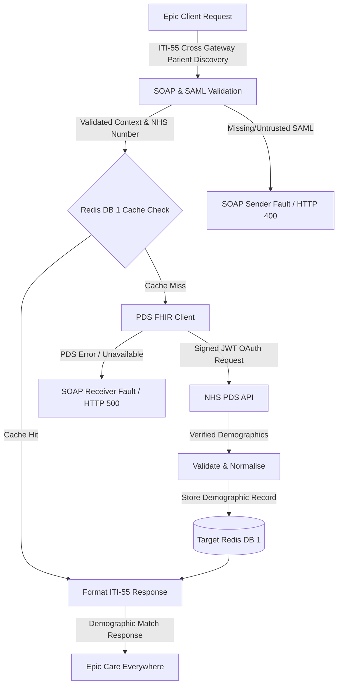
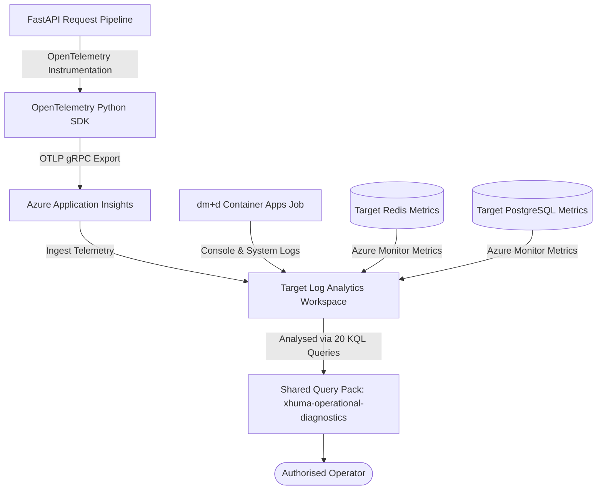
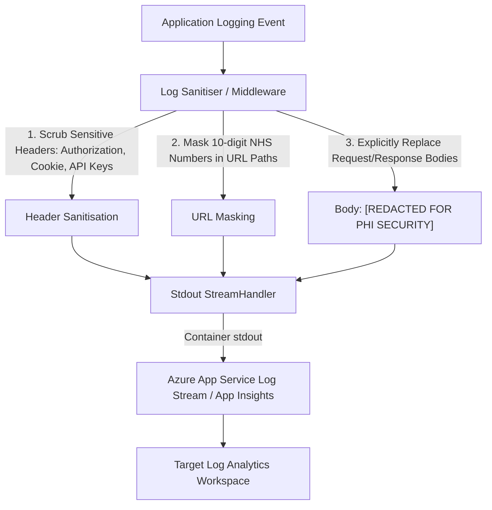
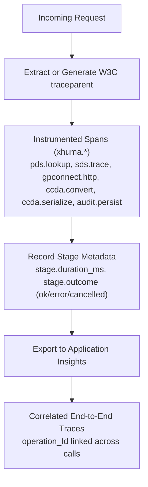
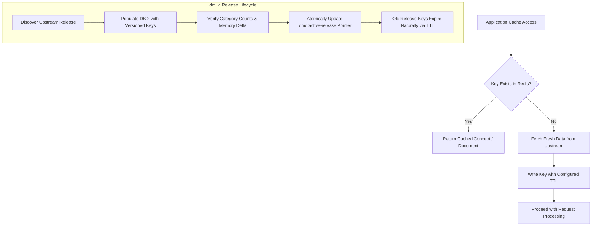
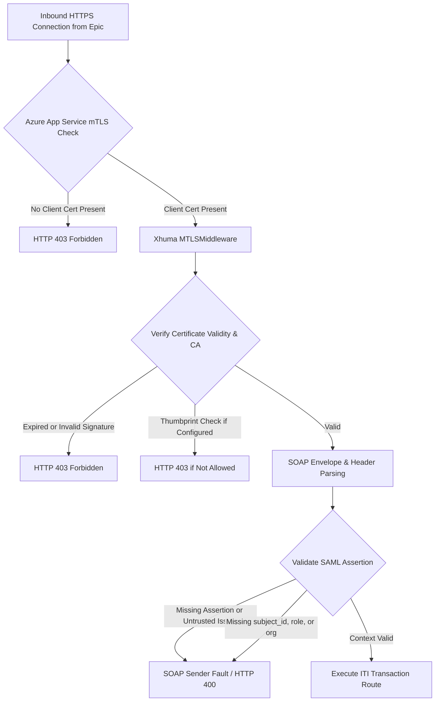
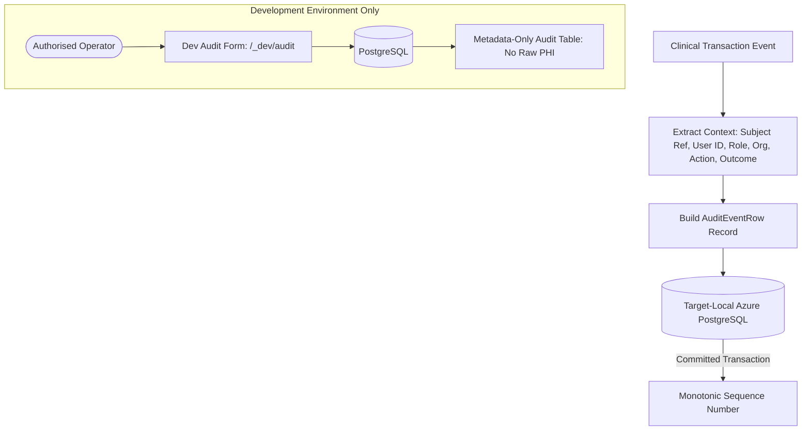
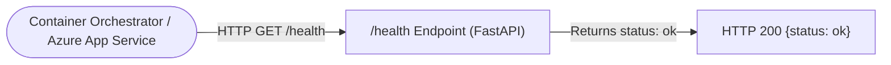

# Data Flow Documentation

This document describes the actual runtime data flows, transformations, observability pipelines, and security checkpoints implemented in Xhuma.

---

## 1. Core Clinical Data Flows

### 1.1 Patient Demographics Service (PDS) Flow (ITI-55)


### 1.2 Structured Record Query & Retrieval Flow (ITI-38 & ITI-39)

```mermaid
flowchart TD
    subgraph ITI38 [Stage 1: Document Query - ITI-38]
        Req38[Epic ITI-38 Request] --> Val38[Validate SAML & Extract NHS Number]
        Val38 --> CacheCheck{Document Cache Check}
        CacheCheck -->|Cache Hit| MetaOnly[Return Document Metadata & ID]
        CacheCheck -->|Cache Miss| SDS[SDS Lookup: GP Endpoint & ASID]
        SDS --> GPC[GP Connect Client]
        GPC -->|FHIR STU3 Query via Relay/Direct| GP[GP Practice System]
        GP -->|FHIR Structured Bundle| Convert[FHIR to C-CDA Converter]
        Convert --> StoreDoc[(Target Redis DB 0: Cache C-CDA)]
        StoreDoc --> Audit38[(Target PostgreSQL: Audit Generation)]
        Audit38 --> MetaOnly
        MetaOnly --> Resp38[ITI-38 AdhocQueryResponse to Epic]
    end

    subgraph ITI39 [Stage 2: Document Retrieval - ITI-39]
        Req39[Epic ITI-39 Request] --> Val39[Validate SAML & Extract DocumentUniqueId]
        Val39 --> RetrieveFromCache[(Target Redis DB 0: Retrieve by Document ID)]
        RetrieveFromCache -->|Document Found| Format39[Package C-CDA into MTOM/XOP Payload]
        RetrieveFromCache -->|Document Not Found| Err39[IHE XDSDocumentUniqueIdError Fault]
        Format39 --> Audit39[(Target PostgreSQL: Audit Retrieval)]
        Audit39 --> Resp39[Deliver ITI-39 Response to Epic]
    end
```


---

## 2. Telemetry and Observability Data Flows

### 2.1 Metrics and Dependency Flow (Azure Monitor / OpenTelemetry)


### 2.2 Application Logging and PHI Minimisation Flow


### 2.3 Distributed Tracing Flow


---

## 3. Data Transformations

### 3.1 PDS Data Transformation
```text
Input: 10-digit NHS Number (validated via modulus 11 checksum)
  │
  ▼
NHS PDS FHIR API Query (JSON)
  │
  ▼
Raw Patient FHIR Resource (Name, Address, DOB, Gender, Managing Organization)
  │
  ▼
Extraction & Transformation to IHE ITI-55 XML Schema
  │
  ▼
Output: HL7 v3 Patient Discovery Response Envelope
```

### 3.2 FHIR to C-CDA Conversion
```text
Input: GP Connect FHIR STU3 Structured Record Bundle
  │
  ├─► Allergies & Adverse Reactions (AllergyIntolerance -> C-CDA Section 48765-2)
  ├─► Medications & Prescriptions (MedicationStatement -> C-CDA Section 10160-0; dm+d resolution)
  ├─► Clinical Problems & Conditions (Condition -> C-CDA Section 11450-4)
  ├─► Diagnostic Investigations & Observations (Observation -> C-CDA Section 30954-2; graph grouping)
  └─► Immunisations (Immunization -> C-CDA Section 11369-6)
  │
  ▼
XML DOM Construction & Serialization (C-CDA Release 2.1)
  │
  ▼
Output: Consolidated CDA XML Document
```

---

## 4. Cache and Storage Data Flows

### 4.1 Redis Cache Operations


---

## 5. Security & Authentication Flow



---

## 6. Audit Trail Flow



---

## 7. Process Liveness Architecture



> [!IMPORTANT]
> **Coarse Process Liveness Only:**  
> The `/health` endpoint is unauthenticated and performs a fast, coarse process-liveness check confirming that the Uvicorn worker process is running and accepting HTTP connections. It does **not** execute automated dependency health probes (Spine, Redis, PostgreSQL), does **not** test downstream reachability, and does **not** trip circuit breakers or trigger automated failover routines. Complete functional readiness must be verified through the operational procedures in the [Operator's Manual](../operations/operators_manual.md).
