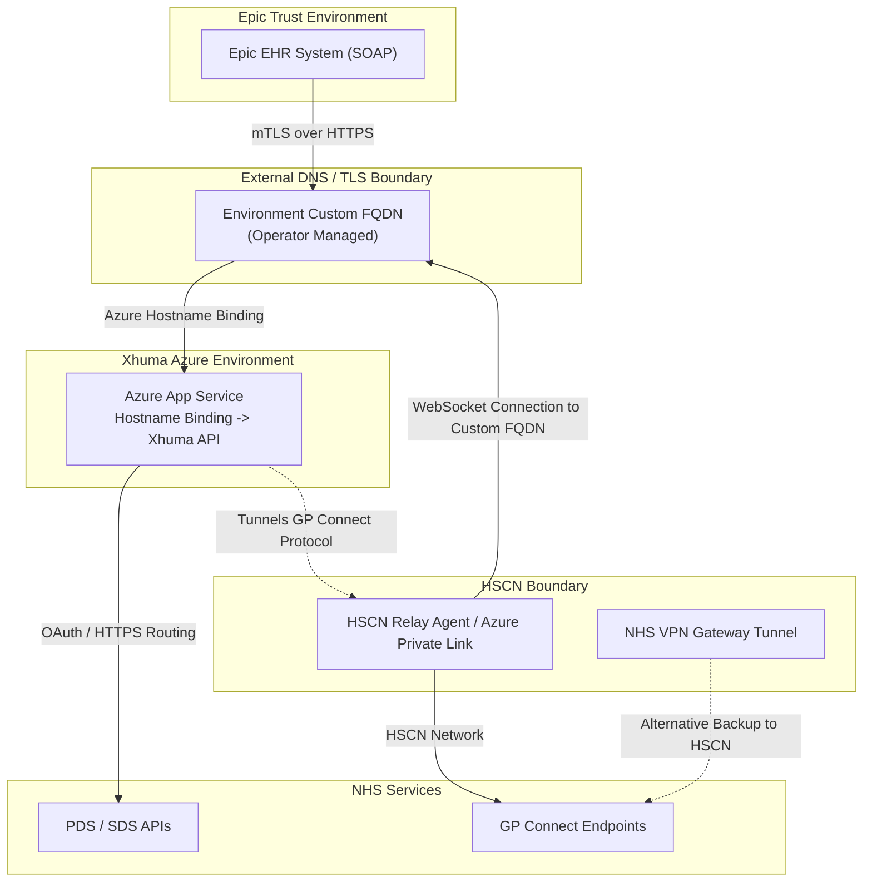

# General Network & Infrastructure Architecture

This document provides an overview of the Xhuma middleware network architecture. It details the Azure cloud infrastructure, CI/CD deployment pipelines, API dependencies, and the networking models required for secure NHS integration (distinguishing the current supported HSCN route, previously tested capabilities, and conditional future architecture).

## 1. Cloud Infrastructure (Azure)

Xhuma's cloud infrastructure is provisioned via Terraform (`infra/main.tf`). The infrastructure is hosted on Microsoft Azure across target-isolated resource groups (Play, INT, and PRD targets), with centrally managed shared services maintained in a dedicated shared Xhuma Azure services scope.

### Azure Components
* **Target-Local Resource Groups (`<target-resource-group>`):**
  * **App Service (Linux Web App):** The main API container host (`python:3.13-slim`). It runs the containerised FastAPI application and serves incoming HTTP/SOAP traffic over TLS. WebSockets are enabled to support outbound reverse tunnelling.
  * **PostgreSQL Flexible Server:** Dedicated target-local relational storage for clinical audit logging and service configuration, protected by private VNet integration (`db-subnet`).
  * **Azure Cache for Redis:** Managed in-memory cache partitioned into DB 0 (C-CDA documents), DB 1 (PDS/SDS lookups), and DB 2 (pre-warmed dm+d terminology), protected by TLS and target VNet firewalls.
  * **Target Virtual Network & Subnets:** Dedicated target VNet containing `app-subnet` (App Service integration), `db-subnet` (delegated to PostgreSQL), and `ca-subnet` (delegated to Container Apps Environment for dm+d warmer).
  * **Local Key Vault:** Stores target-specific certificate bundles (such as `epic-ca-cert`).
  * **Target Observability:** Target-local Log Analytics Workspace and Application Insights component capturing OpenTelemetry traces, dependencies, and application logs.
* **Shared Services Scope (`<shared-resource-group>`):**
  * **Shared Key Vault:** Centrally managed vault holding NHS API credentials, signing keys, and dm+d client credentials, accessible only from authorized target subnets via guarded network rules.
  * **Public JWKS Blob Storage:** Static `$web` storage publishing the public JSON Web Key Set for upstream NHS token verification.
  * **Operational Diagnostics Query Pack:** Standardised cross-target query definitions (`xhuma-operational-diagnostics`).

---

## 2. CI/CD Deployment Flow

Xhuma uses GitHub Actions for automated deployment via a unified, target-isolated matrix deployment model (`.github/workflows/matrix-deploy.yml`).

Target environments and branch mappings are defined in `infra/targets.json`:

```text
feature/* → dev → int → main
              │      │      │
              ▼      ▼      ▼
            Play    INT    PRD
```

- **PR-Based Promotion:** Promotion across environments is strictly pull-request-based. Direct unreviewed branch pushes are not used for releases.
- **Target Isolation:** Every target environment (Play, INT, PRD) maintains isolated Terraform remote state in its own storage account within the target resource group.
- **Existing-State Migration Guards:** Brownfield environments (`INT` and `PRD`) enforce fail-closed existing-state preflight checks (`require_existing_state = true`) to prevent accidental resource destruction or unadopted infrastructure creation.
- **Controlled Stages & Approval Gates:** Infrastructure Plan, infrastructure Apply, and application deployment are distinct controlled stages with environment approval gates.
- **Immutable Container Digest:** Each target deployment uses the exact immutable SHA-256 digest built, scanned with Trivy, and verified for that specific deployment run.
- **Shared Key Vault Network Reconciliation:** Shared Key Vault network rules are reconciled via guarded target-specific plans (`guard_shared_plan.py`) to admit required target subnets while preserving all existing rules.

### General Deployment Stages

1. **CI, Test & Vulnerability Scan:** The workflow runs all tests and builds the candidate Docker image, scanning for CVEs using Trivy.
2. **Registry Push:** The verified image is pushed to GitHub Container Registry (`ghcr.io/uclh-digital-innovation-hub/xhuma`) pinned to its exact SHA-256 digest.
3. **Plan & Gate:** The workflow generates an immutable cryptographic Terraform plan (`.tfplan`) with a published SHA-256 hash. Any unexpected destroy or replacement action halts execution. Authorised operators review the plan summary before approval.
4. **Infrastructure Apply:** Consumes the exact reviewed plan artefact from Azure Blob Storage.
5. **Shared Reconciliation:** Reconciles target subnets (e.g. App Service integration subnet, Container Apps Job subnet) into the shared Key Vault network rules under strict guard validation.
6. **Application Deployment:** Deploys the exact scanned image digest to the target Azure Web App and verifies process liveness via `/health`.

---

## 3. Application Programming Interfaces (APIs)

Xhuma acts as a translator between inbound Epic SOAP transactions and outbound NHS FHIR REST APIs.

### 3.1 Inbound Integrations (Epic -> Xhuma)
The Trust's Epic EHR connects to Xhuma over HTTPS utilising mutually authenticated TLS (mTLS). Client certificates are validated by verifying validity dates, cryptographic signature against the configured Epic CA bundle (`EPIC_CA_CERT`), and optional fingerprint allowlists. Xhuma provides a SOAP-compliant FastAPI router (`app/soap/soap.py`) that handles standard IHE ITI Profiles:
* **ITI-55:** Cross Gateway Patient Discovery (Patient Demographics via PDS).
* **ITI-38:** Cross Gateway Document Queries (retrieves and converts GP Connect record on cache miss).
* **ITI-39:** Cross Gateway Document Retrieve (serves cached C-CDA XML documents from Redis DB 0).

### 3.2 Outbound Integrations (Xhuma -> NHS)
Xhuma processes the inbound IHE ITI requests and converts them into NHS FHIR calls:
* **PDS (Patient Demographics Service):** Routed over HTTPS via `https://int.api.service.nhs.uk/` (or production endpoint). Secured via NHS OAuth2 Client Credentials (signed JWT assertion).
* **SDS (Spine Directory Service):** Routed over HTTPS to query FHIR endpoints and routing identifiers using API keys.
* **GP Connect (Structured Records):** GP Connect requests have specific network routing models detailed below.

---

## 4. GP Connect Network Models

Xhuma distinguishes between the current supported production routing model, previously tested capabilities, and conditional future architecture.

### 4.1 Current Supported Route: HSCN Relay (`USE_RELAY = 1`)

Due to NHS network access constraints on GP Connect endpoints, Xhuma operates an outbound reverse WebSocket HSCN Relay architecture:

An HSCN-connected agent (e.g., via Azure Private Link or an internal NHS VPN Gateway) establishes a WebSocket connection inbound to the Xhuma Azure App Service. GP Connect requests are securely tunnelled back down this WebSocket to the agent, which executes the query natively against HSCN. This allows Xhuma's main infrastructure to remain purely cloud-native while satisfying NHS network requirements.

> **Note on Custom Domains:** External integration endpoints (including Epic and the Relay) do not target the default Azure App Service hostname directly. They target an externally agreed environment custom FQDN (e.g., `int.<trust>.xhuma.co.uk`), which is then bound to the Xhuma App Service via an operator-managed Azure hostname binding. DNS and the associated custom TLS certificates are currently managed manually outside of the Terraform infrastructure lifecycle.



### 4.2 Previously Tested Capabilities & Conditional Future Architecture

- **Previously Tested Capability:** Xhuma previously exercised direct over-the-internet queries to GP Connect (`USE_RELAY = 0`) during a limited non-production pilot, proving the technical viability of direct HTTPS transport.
- **Conditional Future Architecture:** A full transition away from the HSCN relay to direct internet-facing GP Connect endpoints remains conditional upon:
  1. NHS England policy confirmation and national endpoint availability across all participating GP practices;
  2. Local Trust Information Governance (IG) approval and updated Data Protection Impact Assessment (DPIA) sign-offs;
  3. Supplier Conformance Assessment List (SCAL) alignment for internet transport.

Do not present unconfirmed NHSE policy timelines as fact. Direct internet routing remains an engineered capability ready to be enabled if and when national policy and local governance permits.

```mermaid
flowchart TD
    subgraph Client [Epic Trust Environment]
        A[Epic EHR System]
    end

    subgraph Azure [Xhuma Azure Environment]
        B[Xhuma API Container]
    end

    subgraph NHS [NHS Services]
        C[Internet-facing GP Connect Endpoints]
        D[Internet-facing PDS/SDS APIs]
    end

    A -->|mTLS over HTTPS| B
    B -->|mTLS + JWT over HTTPS (Conditional Future Path)| C
    B -->|OAuth/API Key over HTTPS| D
```
