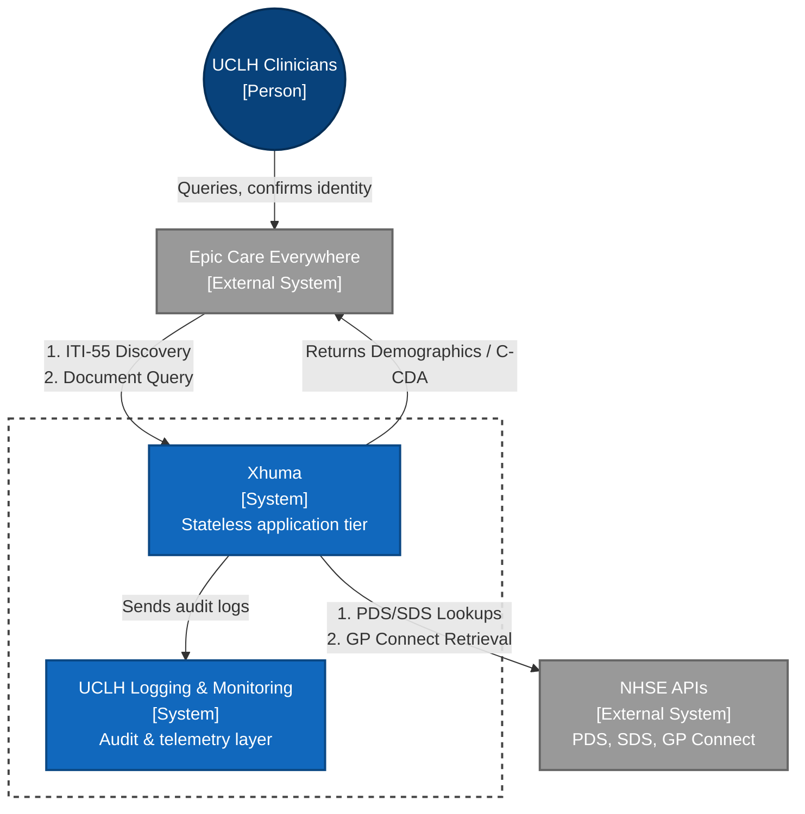
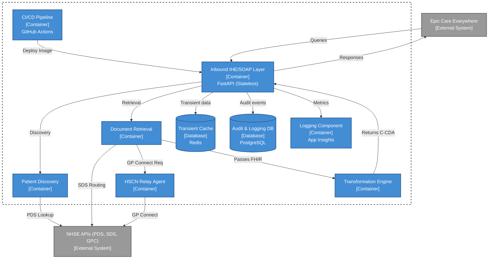
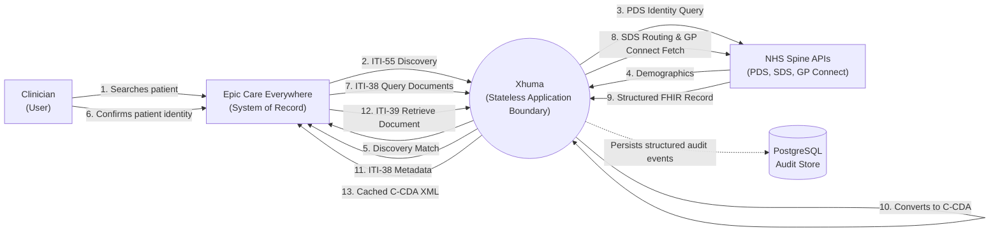
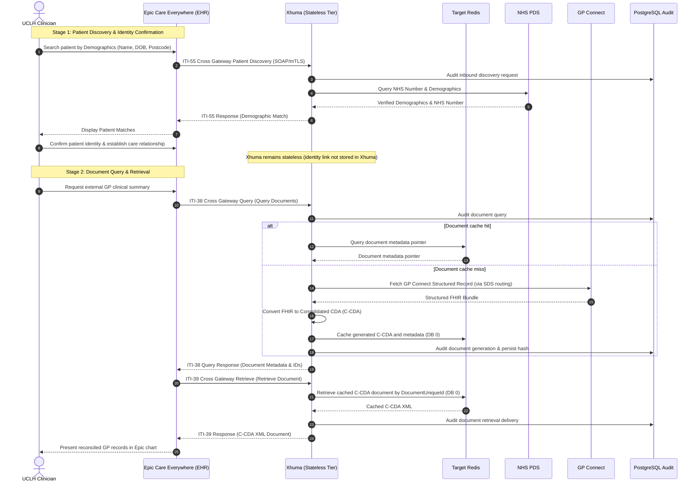

# Technical Architecture Documentation

## System Overview

The Xhuma application tier is stateless. It acts as an intermediary middleware service between Electronic Health Record (EHR) systems (such as Epic Care Everywhere) and NHS APIs (PDS, SDS, GP Connect), facilitating the conversion of GP Connect structured records into CCDA (Consolidated Clinical Document Architecture) format.

All system state is strictly externalised:
- **Transient & Optimisation State:** Demographic query caches, directory routing details, and assembled C-CDA documents are externalised to target-local Redis;
- **Durable Clinical Audit State:** Structured clinical audit records and transaction events are stored in target-local PostgreSQL;
- **Cryptographic Keys & Secrets:** NHS signing keys, certificates, and external credentials are externalised to Azure Key Vault;
- **Stateless Instances:** Application container instances do not rely on local persistent disk or in-memory session affinity, allowing seamless horizontal scaling and deterministic container restarts.

## Architecture Diagrams

*(Note: The following diagrams align Xhuma's system model to clinical workflows and DTAC/DCB0160 assurance expectations, explicitly highlighting Epic as the system of record and Xhuma as a stateless middleware tier.)*

### System Context


### Container Diagram


### Component Diagram
```mermaid
flowchart TD
    classDef ext_system fill:#999,color:#fff,stroke:#666,stroke-width:2px;
    classDef comp fill:#85bbf0,color:#000,stroke:#5b82a8,stroke-width:2px;
    classDef db fill:#438dd5,color:#fff,stroke:#2e6295,stroke-width:2px;
    classDef boundary fill:none,color:#fff,stroke:#444,stroke-width:2px,stroke-dasharray: 5 5;

    %% External
    Epic["Epic Care Everywhere\n[System]"]:::ext_system
    NHSE["NHSE APIs\n[System]"]:::ext_system
    AuditDB[("Audit DB\n(Postgres)")]:::db
    RedisDB[("Transient Cache\n(Redis)")]:::db

    subgraph AppBoundary[Xhuma Application Boundary]
        Router["FastAPI Router\n[/SOAP/iti55, /SOAP/iti38, /SOAP/iti39]"]:::comp
        SOAPParse["SOAP & SAML Handler\n[app/soap/]"]:::comp
        PDSClient["PDS Client\n[app/pds/]"]:::comp
        GPCClient["GP Connect Client\n[app/gpconnect.py]"]:::comp
        CCDAEngine["CCDA Converter\n[app/ccda/]"]:::comp
        AuditLogger["Audit Service\n[app/audit/]"]:::comp
    end
    class AppBoundary boundary;

    Epic -->|SOAP Request| Router
    Router --> SOAPParse
    SOAPParse -->|Validated Context| Router
    
    Router -->|ITI-55 Patient Discovery| PDSClient
    Router -->|ITI-38 Query Docs (on cache miss)| GPCClient
    Router -->|ITI-39 Retrieve Doc| RedisDB
    
    PDSClient -->|Query| NHSE
    GPCClient -->|Fetch FHIR| NHSE
    
    GPCClient -->|FHIR Bundle| CCDAEngine
    CCDAEngine -->|Generated C-CDA| Router
    
    Router -->|Log access/events| AuditLogger
    AuditLogger --> AuditDB
    
    Router -->|Cache responses/tokens/documents| RedisDB
```

---

## Data Flow Diagrams

### DFD Level 0 (Context Level)


### Clinician Interaction Sequence


---

## Technical Specifications

### System Requirements
- **Runtime Environment:** Containerised Linux on Azure App Service (`python:3.13-slim`)
- **Language / Framework:** Python 3.13, FastAPI, Uvicorn
- **Cache / In-Memory Store:** Azure Cache for Redis (DB 0: C-CDA documents, DB 1: PDS/SDS cache, DB 2: dm+d terminology)
- **Database:** Azure Database for PostgreSQL Flexible Server (Audit logs, transaction history)
- **Identity & Secrets:** Azure Key Vault (Shared Key Vault for global secrets, Local Key Vault for target certificates)

---

## Core Components

### 1. API Layer (FastAPI)
- Handles incoming IHE ITI requests:
  - `/SOAP/iti55` -> Cross Gateway Patient Discovery; performs PDS patient verification.
  - `/SOAP/iti38` -> Cross Gateway Query; checks document cache and triggers GP Connect retrieval + FHIR-to-C-CDA conversion on cache miss.
  - `/SOAP/iti39` -> Cross Gateway Retrieve; retrieves previously cached C-CDA documents directly from Redis DB 0 (does not independently call GP Connect).
- Enforces HTTP request timeouts, connection pooling, and structured logging.
- Implements async route handlers for high-throughput concurrency.

### 2. Authentication & Security (`app/security.py`, `app/middleware/mtls.py`)
- Inbound transport authenticated through Epic mutual TLS (mTLS), verifying client certificate presence, validity dates, cryptographic signatures against the configured Epic CA bundle, and optional thumbprint allowlists.
- SAML assertion presence and structure validated against trusted issuer allow-lists, requiring `subject_id`, `organization`, `organization_id`, and `role`.
- Outbound request signing using JSON Web Tokens (JWT) for NHS API authentication.
- Dynamic JWKS key rotation supporting current and previous active key versions.

### 3. GP Connect Integration (`app/gpconnect.py`)
- Communicates with upstream GP Connect APIs via reverse WebSocket relay agent or direct HTTPS where configured.
- Retrieves structured FHIR STU3 resources (Allergies, Medications, Observations, Problems).
- Configured HTTP request timeouts and structured diagnostic logging.

### 4. CCDA Conversion Engine (`app/ccda/`)
- Transforms FHIR bundles into C-CDA XML documents adhering to HL7 specifications.
- Implements clinical mapping rules for allergies, structured dm+d doses, and lab investigations.
- Output serialisation and structure are verified against standard schemas in automated testing and assurance suites.

### 5. PDS Integration (`app/pds/`)
- Verifies patient identities against the NHS Personal Demographics Service (FHIR R4 where implemented).
- Validates NHS numbers with check-digit algorithms.
- Caches verified patient demographics in Redis DB 1 with pseudonymous HMAC hashing.

### 6. SOAP Handler (`app/soap/`)
- Parses incoming SOAP envelopes, WS-Addressing headers, and SAML tokens.
- Constructs specification-compliant SOAP responses and fault payloads (SOAP Sender fault / HTTP 400 or SOAP Receiver fault / HTTP 500).

### 7. Redis Cache Architecture (`app/redis_connect.py`)
- **DB 0:** C-CDA documents (configurable TTL, default 4 hours).
- **DB 1:** PDS lookup results (24-hour TTL), SDS routing details (12-hour TTL).
- **DB 2:** Pre-warmed dm+d terminology concepts (9-day TTL).
- **Instance-wide physical memory:** Redis memory limits and eviction policies are instance-wide across all logical databases.

---

## dm+d Terminology Cache & Warmer Architecture

The Dictionary of Medicines and Devices (dm+d) cache warmer ensures that high-volume medication concept resolutions execute with low-millisecond target-local Redis lookups from target-local Redis rather than making blocking network calls to the NHS Terminology Server during clinical document conversion.

For clinical dosage and route mapping specifications, see [dm+d Mapping Overview](../clinical-mapping/dm+d_mapping.md).  
For operational runbooks and troubleshooting, see [Operator's Manual](../operations/operators_manual.md#10-dmd-cache-warmer-operations-and-diagnostics).

### Target-Local v1.0 Architecture

The warmer is designed as **standard target-local operational infrastructure** across all Xhuma targets:
- Runs as an Azure Container Apps Job (`azurerm_container_app_job.dmd_warm`) provisioned with a **manual trigger configuration**.
- Warms target-local Redis DB 2.
- Runs the same digest-pinned Xhuma application image (`var.dmd_cache_job_image`) built and scanned by CI.
- Resolves dm+d credentials (`dmd-client-id`, `dmd-client-secret`) at runtime from the shared Key Vault using the Job's user-assigned managed identity.
- Exposes no public control endpoint.

### Configured Target Baseline in v1.0

- **Configured Target Baseline in v1.0:**
  - Play: Target-local warmer infrastructure enabled (`dmd_cache_warm_enabled = true`); scheduler disabled (`dmd_cache_schedule_enabled = false`). Play remains the manually exercised non-production warmer target.
  - INT: Target-local warmer infrastructure and weekly Monday 05:00 UK schedule enabled (`dmd_cache_warm_enabled = true`, `dmd_cache_schedule_enabled = true`, `dmd_cache_warm_minute = 0`, start time `2026-10-12T05:00:00`). Inherits default dm+d endpoint.
  - PRD: Target-local warmer infrastructure and weekly Monday 05:00 UK schedule enabled (`dmd_cache_warm_enabled = true`, `dmd_cache_schedule_enabled = true`, `dmd_cache_warm_minute = 0`, start time `2026-10-12T05:00:00`). Retains explicit production direct-care endpoint (`https://ontology.nhs.uk/production2/fhir`).
  - Note: The global Terraform default remains `false`; enablement is deliberate per target.

### Terminology Publication & Warm Schedule

- **Operational Assumption:** Refreshed upstream dm+d releases are expected to become available weekly on **Monday at approximately 04:00 UK local time** via TRUD / NHS Terminology Server. This is a project operational planning assumption based on observed release operations, **not** an externally guaranteed NHS SLA. Occasional small publication delays can occur.
- **Target Warm Schedule:** Xhuma targets warming on **Monday at approximately 05:00 UK local time** (`GMT Standard Time`, DST-aware across GMT/BST), providing around one hour of publication headroom.
- **Natural Retirement (No Purge):** The operational lifecycle is:
  $$\text{discover} \longrightarrow \text{warm} \longrightarrow \text{verify} \longrightarrow \text{activate} \longrightarrow \text{retire naturally by TTL}$$
  New release keys are versioned (`dmd:resolved:v1:<release>:<concept_id>`). The active pointer (`dmd:active-release`) is atomically updated only after full verification. The prior release is not deleted; old keys age out naturally under their 9-day TTL. `FLUSHDB` and wildcard `KEYS *` are strictly prohibited.

### Release-Freshness and Scheduler Monitoring

INT and PRD schedule the target-local dm+d warmer for Monday 05:00 UK local time. Logic App trigger and run failures are routed through Azure Monitor to the operator-supplied Action Group (`azurerm_monitor_metric_alert.la_triggers_failed`, `la_runs_failed`). First-environment commissioning remains manual. Release freshness is verified operationally after the first scheduled cycle; automated freshness alerting is deferred until its telemetry query is proven against Play.

A `warm_succeeded` event confirms complete successful caching and activation of the release visible upstream at execution time. The warmer Container Apps Job can also be triggered manually via CLI or Azure Portal.

### Proven Safety Invariants

1. **Job Execution Timeout:** 1800 seconds (`replica_timeout_in_seconds = 1800`).
2. **Zero Replica Retries:** `replica_retry_limit = 0`.
3. **Scheduler Polling Envelope:** 2100 seconds (`local.dmd_logic_poll_timeout_seconds = 2100`).
4. **Distributed Warmer Lock TTL:** 2700 seconds (`local.dmd_lock_ttl_seconds = 2700`, acquired at `dmd:warm:v1:lock`).
5. **Timeout Hierarchy:** $1800\text{s (job)} < 2100\text{s (poll)} < 2700\text{s (lock)}$.
6. **Digest-Pinned Image:** Job runs the exact scanned digest (`var.dmd_cache_job_image`).
7. **Monotonic HTTP Retry Budget:** Upstream queries clamped to an overall 120-second monotonic deadline.
8. **Redis Memory Safety Preflight:** Aborts before writes if current memory + projected delta with 1.5x multiplier exceeds 80% of `maxmemory`.
9. **Zero Eviction Tolerance:** Aborts immediately if `evicted_keys` increases by even 1 key during warming.
10. **Grace Period Coexistence:** 9-day data TTL vs 8-day active pointer TTL provides a 24-hour grace window during schedule delays.
11. **Prohibited Commands:** `FLUSHDB` and wildcard `KEYS *` are strictly forbidden.

---

## Monitoring & Observability Architecture

Xhuma's production telemetry foundation consists of:
- **Application Insights & Log Analytics:** Ingestion of traces, dependencies, requests, and exceptions per target;
- **OpenTelemetry Instrumentation:** FastAPI middleware emitting traces, metrics, and correlated operation IDs;
- **Shared Azure Monitor Query Pack:** Cross-target operational diagnostics via `xhuma-operational-diagnostics` in the shared Xhuma Azure services scope;
- **Operational Diagnostic Guide:** Detailed in [Observability & Diagnostics Guide](../operations/observability.md).

---

## Deployment Architecture

### Matrix Deployment Model

Xhuma uses a unified target-isolated matrix deployment workflow (`.github/workflows/matrix-deploy.yml`) driven by target definitions in `infra/targets.json`:

```text
feature/* ──(PR)──> dev ──(PR)──> int ──(PR)──> main
                      │             │             │
                      ▼             ▼             ▼
                     Play          INT           PRD
```

- **PR-Based Promotion:** Promotion across environments is strictly pull-request-based.
- **Target-Isolated State:** Each target environment (Play, INT, PRD) maintains its own isolated Terraform remote state in Azure Blob Storage within its dedicated target-local resource group.
- **Controlled Stages & Approval Gates:** Plan, infrastructure Apply, and application deployment are distinct controlled stages protected by GitHub Environment approval gates.
- **Immutable Scanned Digest Verification:** Each target deployment uses the exact immutable SHA-256 digest built, scanned with Trivy, and verified for that specific deployment run.
- **Fail-Closed Migration Guards:** Brownfield targets (`INT` and `PRD`) enforce fail-closed existing-state preflight checks (`require_existing_state = true`). Unexpected destructive replacement halts deployment immediately.
- **Guarded Shared Key Vault Network Admission:** Shared Key Vault network rules are reconciled via ephemeral plans strictly guarded by `guard_shared_plan.py`.

### Resource-Group & Target Topology

Xhuma operates across target-isolated resource groups, with centrally managed shared services maintained in a dedicated shared Azure services scope:

```text
Target Environment Footprint (Play, INT, PRD):
├── Azure App Service (Linux Web App, python:3.13-slim)
├── Azure Managed Redis (Cache DB 0: C-CDA, DB 1: PDS/SDS, DB 2: dm+d)
├── Azure Flexible PostgreSQL (Audit persistence & configuration)
├── Azure Key Vault (Target-local secrets & certificate allowlists)
├── Target Virtual Network & Dedicated Subnets (app-subnet, db-subnet, ca-subnet)
├── Target Log Analytics Workspace & Application Insights
└── Azure Container Apps Job (dm+d warmer; target-local manual trigger)

Centrally Managed Shared Services (Shared Scope):
├── Shared Key Vault (Global NHS API keys, signing keys, dm+d credentials)
├── Public JWKS Blob Storage ($web static endpoint)
└── Azure Monitor Query Pack (xhuma-operational-diagnostics, 20 KQL queries)
```
