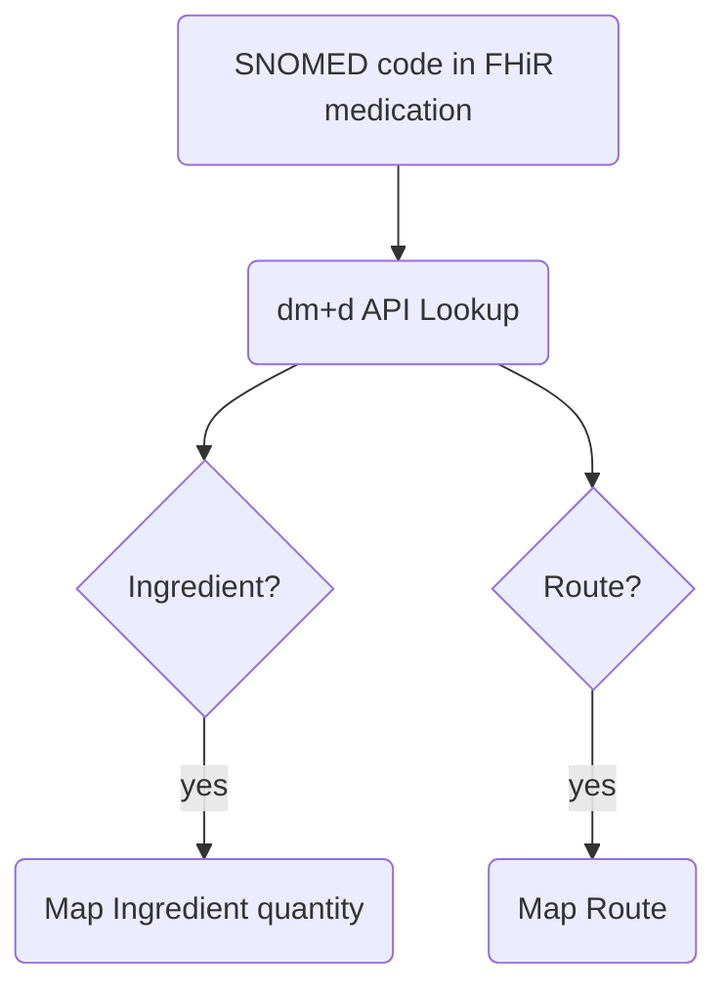
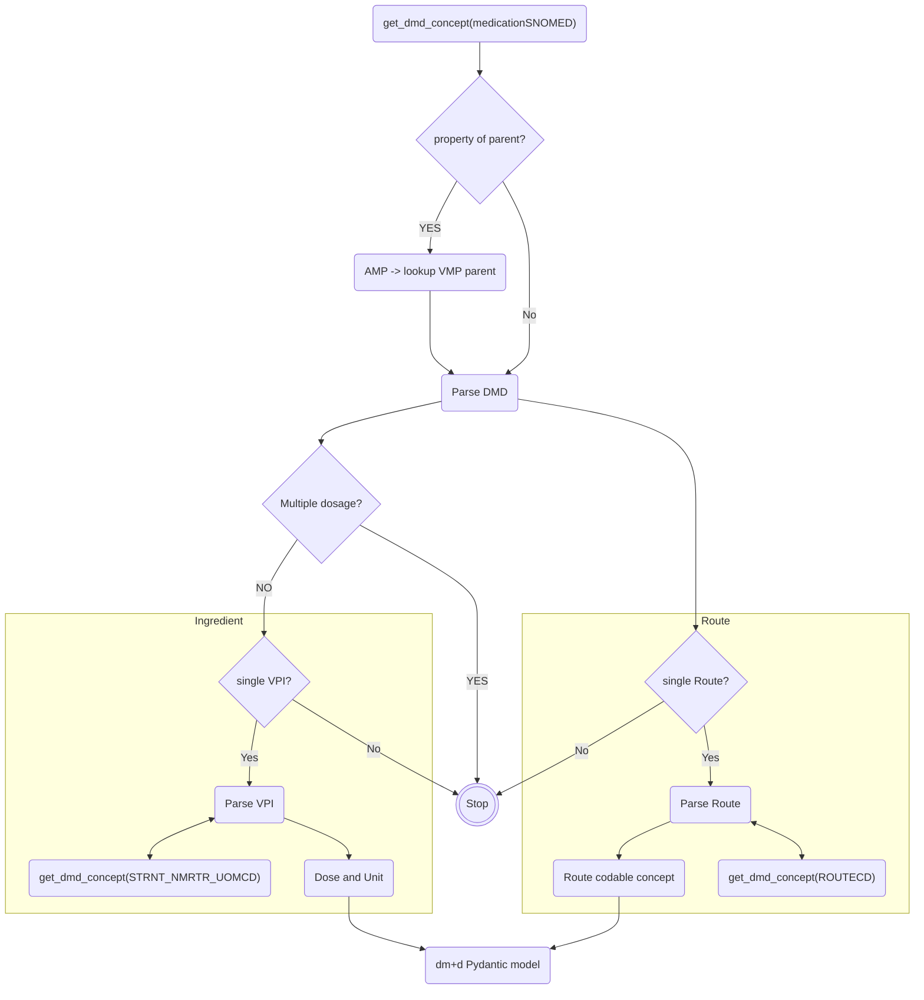
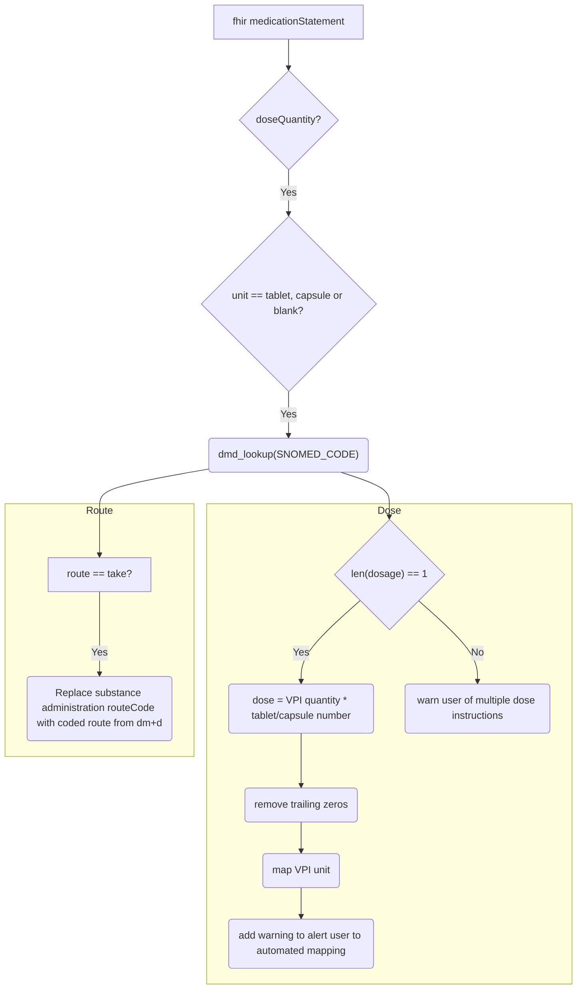
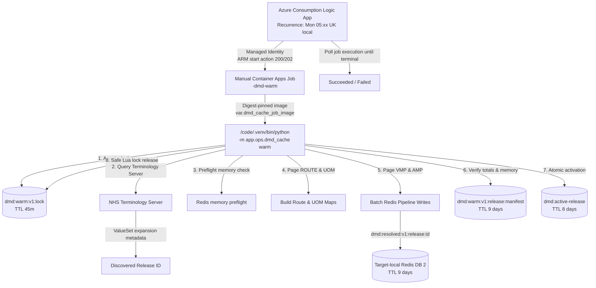

# dm+d Mapping overview

## Overview

Structured medication prescription data from GP systems is limited in that GP's prescribe fixed quantities of a specific medicinal product. This results in almost all structured doses being in the form of a integer quantity of tablet or capsule.

Example fhir dosage snippet:
```json
"dosageInstruction": [
                    {
                        "text": "1 tablet, daily",
                        "timing": {
                            "repeat": {
                                "frequency": 1,
                                "period": 1,
                                "periodUnit": "d"
                            }
                        },
                        "doseQuantity": {
                            "value": 1,
                            "unit": "tablet",
                            "system": "http://snomed.info/sct",
                            "code": "428673006"
                        }
                    }
                ],
```

As we can see from this typical example the dose quantity is for a single tablet rather then for a dose of drug in units such as mg and so will not map naturally to secondary care prescribing systems. We also do not have a route but this is typically "take" for prescriptions originating in GP systems and again does not map.

## Options

### REGEX
One potential solution would be to use regular expressions to identify the dose within the text of the drug name. For many commonly prescribed medications this would be relatively trivial e.g. the following coded medication could trivially be parsed to 15mg
 ```json
 "code": {
                    "coding": [
                        {
                            "system": "https://fhir.hl7.org.uk/Id/emis-drug-codes",
                            "code": "LAOR14898NEMIS",
                            "display": "Lansoprazole 15mg orodispersible tablets",
                            "userSelected": true
                        },
                        {
                            "system": "http://snomed.info/sct",
                            "code": "4053411000001103",
                            "display": "Lansoprazole 15mg orodispersible tablets"
                        }
                    ]
                }
 ```
However at the scale of the entire UK drug catalogue and taking into account the various medications that are mixtures then any expression would rapidly become unwieldy and introduce significant risk into the process

### dm+d
The Dictionary of Medicines and Devices is an assured dictionary or medicines and devices that are used within the NHS. It allows for mapping of drugs from virtual medicinal products to their base ingredients as well as provides additional information such as their appropriate chapter in the BNF, controlled drug status and other information such as tariff information.

Importantly dm+d also includes the specific quantity of drug and unit in an assured way as well of a list of approved routes.

There are two ways of consuming dm+d. Data is released weekly via the TRUD service which is free to sign up to, [Mark Wardle](https://github.com/wardle/dmd) has written an excellent microservice that simplifies integration. Additionally the [NHS Terminology Server](https://digital.nhs.uk/services/terminology-server) is a platinum level service that allows for real time queries of dm+d as well as SNOMED.

Xhuma uses the Terminology server for dm+d queries

### Basic flow



### Risks and mitigations

Mapping doses still presents a number of risks. Many medications have several ingredients and a number of routes so simple mapping flows risk introducing errors. Additionally mapping and calculation of doses is only desired for medications that are prescribed in the form of "1 tablet"

| Risk/Problem          | Mitigation |
| --------------------- | ----------- |
| Drug with multiple ingredients      | Only map doses with single ingredients       |
| Drug with multiple routes   | Only map routes with single approved route        |
| Drug prescribed as AMP rather than VMP   | Check if AMP, is so then map parent        |
| Only medications with unitless quantity to be mapped   | Only map doses if unit "tablet", "capsule" or None       |
| More then one dosage instruction  | Stop if len(dosage) == >1      |


### Final Flow



### Integration into C-CDA Medicines section
With a valid pydantic model it is then possible to use this to enhance the medicines data sent as part of the C-CDA.



The workflow is robust to edge cases whilst allowing for more informative mapping for the majority of oral medications that otherwise are difficult to easily consolidate into secondary care systems.

---

## dm+d Cache Architecture & Lifecycle

### Publication & Warm Schedule
- **NHS dm+d Publication**: Weekly on Monday at 04:00 UK time via TRUD / NHS Terminology Server.
- **Xhuma Target Pre-warm**: Weekly on Monday at 05:00 UK local time (DST-aware across GMT/BST), with optional per-target minute offset (`dmd_cache_warm_minute`) to prevent simultaneous upstream thundering herds across trusts.

> [!NOTE]
> Terminology freshness is not guaranteed to be instantaneous; upstream publishing schedules or network delays can occur. Xhuma is architected to safely fall back to runtime on-demand resolution or retain the prior active release within its grace window.

### Architecture Flow


### Key Principles
1. **Target-Local / Shared-Nothing**: Each target environment has its own Container Apps Job and warms its own target-local Redis DB 2. There is no shared terminology microservice and no public/HTTP control endpoint.
2. **Dedicated Digest-Pinned Job Image**: The Container Apps Job image is managed via `var.dmd_cache_job_image` (`${REGISTRY}/${IMAGE_NAME}@${build digest}`). App Service deployment ownership remains with `azure/webapps-deploy` and ignores image-name drift; only the Container Apps Job image is updated in Terraform (`0 to add, 1 to change, 0 to destroy`).
3. **Guarded Shared Key Vault Network Admission**: The `ca_subnet` has `Microsoft.KeyVault` service endpoints enabled. Shared Key Vault receives one guarded in-place ACL update during shared reconciliation: `app-subnet` always, `ca-subnet` only when `dmd_cache_warm_enabled = true`. Plan guarding (`guard_shared_plan.py`) rejects subnet removals, unknown subnet additions, and any other shared resource modification.
4. **Logic App Scheduling & Invariants**:
   - Time zone: `GMT Standard Time` (Monday 05:xx UK local time, DST-aware).
   - Target-configurable start time: `dmd_cache_schedule_start_time` (local `YYYY-MM-DDTHH:MM:SS` format without Z).
   - Invariants: `schedule_enabled => warm_enabled`, start time required when schedule enabled, alert action group required when schedule enabled.
   - Start action handles both HTTP 200 (`body.name`/`body.id`) and HTTP 202 (`Location` header polling).
   - Timing invariant: `replica timeout (1800s) < poll timeout (2100s) < lock TTL (2700s)`.
5. **Warm -> Verify -> Activate Invariant**: Data is pre-warmed into versioned keys (`dmd:resolved:v1:<release>:<concept_id>`). The active pointer (`dmd:active-release`) is updated *only* after all categories complete successfully, totals are verified, and no Redis key evictions occurred.
6. **Natural TTL Retirement (No Purge)**:
   - Resolved concepts (`dmd:resolved:v1:...`): **9 days** TTL
   - Active release pointer (`dmd:active-release`): **8 days** TTL
   - Success manifest (`dmd:warm:v1:...:manifest`): **9 days** TTL
   The active pointer expires before underlying data expires, ensuring a 24-hour grace window for schedule failures while preventing orphaned pointers. Old release data ages out naturally without requiring destructive Redis operations (`DEL`, `KEYS`, `FLUSHDB`).
7. **Redis Memory Safety & Preflight**: The warmer enforces a full-run memory preflight before the first write (projected usage with 1.5x multiplier must remain below 80% ceiling) and checks memory guard and `evicted_keys` on each batch. If `evicted_keys` increases at any point during warming, the run aborts immediately and refuses activation.
8. **Disjoint Namespace & Cache Type Separation**:
   - `dmd:resolved:v1:<release>:<concept_id>`: Only serialized `DMDConcept` instances.
   - `dmd:raw:v1:<release>:<concept_id>` / `snomed:...`: Raw FHIR Parameters dictionaries returned by `get_dmd_concept`.
   - Upstream lookups on cache misses are explicitly pinned to the active release; responses with mismatched releases are rejected before caching.

### Runtime Fallback Behaviour
When `dmd_lookup(concept_id)` executes during prescription conversion:
1. It queries `dmd:active-release`.
2. **Hit with Active Release**: Checks `dmd:resolved:v1:<release>:<concept_id>`. On hit, returns the resolved `DMDConcept` immediately with zero external network calls.
3. **Miss with Active Release**: Resolves the concept on-demand via the Terminology Server pinned to that active release, writes the resolved `DMDConcept` to `dmd:resolved:v1:<release>:<concept_id>`, and returns it.
4. **No Active Release**: Falls back transparently to unversioned on-demand resolution (`dmd:concept:<concept_id>`). A failed Monday warmer never breaks medication processing.

### Operational CLI Commands
The CLI is built directly into the core Xhuma container under `app.ops.dmd_cache`:
```bash
# Execute manual warm
/code/.venv/bin/python -m app.ops.dmd_cache warm

# Inspect operational cache status
/code/.venv/bin/python -m app.ops.dmd_cache status
```
