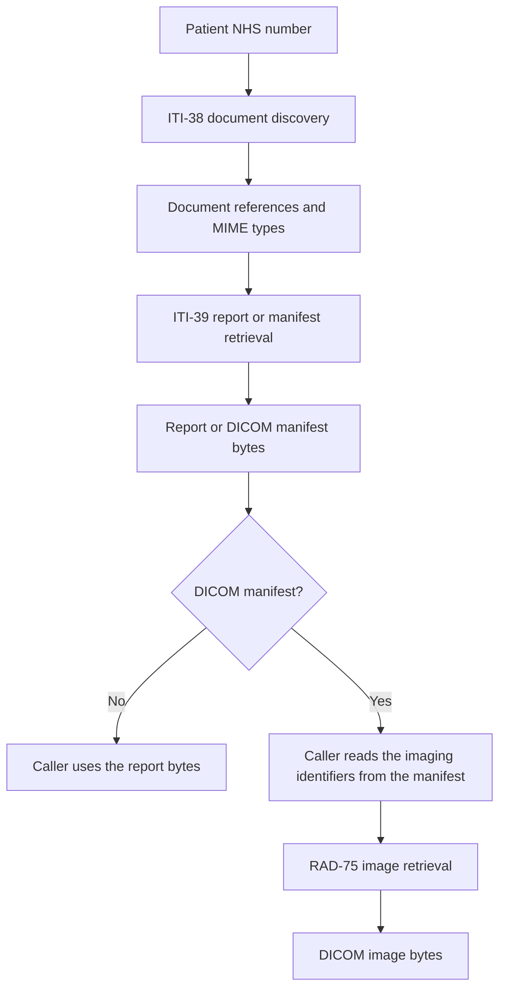
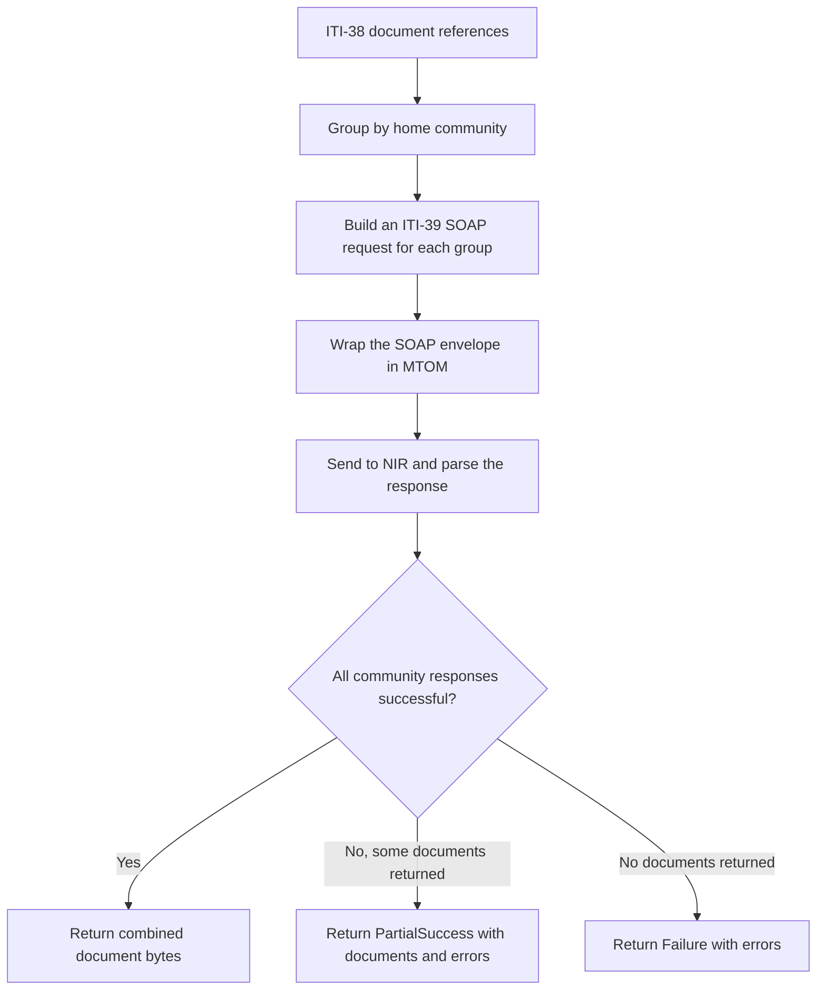

# National Imaging Registry workflow

## Overview

The National Imaging Registry (NIR) consumer discovers a patient's imaging
documents and retrieves reports, DICOM manifests or individual images. NIR
queries participating imaging networks and returns their document references;
Xhuma uses those references for the next request.

The MVP provides an async Python client in `app/nir`. Its IHE models, SOAP
builders and response parsers live in `app/soap/nir_*`. It can run independently
of the existing GP Connect routes, PDS lookups, Redis and relay. There is no new
inbound FastAPI route or automatic C-CDA conversion in this workflow.

## Basic flow



ITI-38 finds documents but does not return their content. ITI-39 retrieves
selected documents, which may include a report or a DICOM manifest. RAD-75
retrieves individual images using the study, series and image identifiers from
the manifest. Manifest decoding is handled by the caller in this MVP.

## Document discovery with ITI-38

`NIRClient.query_documents(nhs_number)` builds a SOAP request and sends it to
`/xca/iti-38`. The sandbox builder checks that the NHS number contains ten
digits and has a valid check digit. This validates the identifier's format;
it does not perform a PDS demographics lookup.

The stored query is `FindDocuments`. It requests approved entries and uses
`LeafClass` so the response includes document metadata. The patient identifier
is sent in IHE CX format, including the NHS number assigning authority:

```text
'9694116422^^^&2.16.840.1.113883.2.1.4.1&ISO'
```

The XML serializer escapes the ampersands. Discovery leaves the query's target
home community unset so NIR can query the participating networks.

Each result becomes a `NIRDocumentReference` with the following fields:

| Field | Purpose |
| --- | --- |
| `home_community_id` | Identifies the imaging community holding the document. |
| `repository_unique_id` | Identifies the repository within that community. |
| `document_unique_id` | Identifies the document to retrieve. |
| `mime_type` | Describes the content, such as `application/pdf` or `application/dicom`. |

The three identifiers together form the retrieval address. The registry entry's
UUID is a separate metadata identifier and is not used as the document UID.
A document UID may occur in more than one community, so the client retains the
community and repository identifiers throughout the workflow.

## Document retrieval with ITI-39

`NIRClient.retrieve_documents(query.documents)` uses the discovery references
to request content from `/xca/iti-39`. Generated sandbox requests are grouped
by home community. During sandbox verification, a mixed-community request
returned routing errors; sending each community's documents separately worked.
This grouping reflects the observed NIR behavior.



MTOM carries a SOAP envelope and binary attachments in a MIME multipart
message. The SOAP root identifies each document and refers to its attachment
through an XOP `cid:` reference. The parser matches that reference to the
attachment's `Content-ID` and preserves the decoded payload as `bytes`.
It also accepts inline base64 document content.

Each returned `NIRRetrievedDocument` contains the retrieval identifiers,
MIME type and binary `content`. A PDF and a DICOM object remain binary; callers
choose how to store or interpret them. Missing attachments, unexpected XML,
invalid base64 and malformed MIME messages are rejected or reported as errors.

If a community returns a registry failure, the combined result retains
documents returned by other communities and reports partial success. HTTP
or transport exceptions raise immediately rather than returning that combined
result. Supplied signed envelopes are sent as supplied, without rebuilding or
splitting their signed content.

## Image retrieval with RAD-75

`NIRClient.retrieve_imaging_documents(studies)` sends an MTOM request to
`/xcai/rad-75`. `NIRImagingStudyRequest` groups series by their study instance
UID, and `NIRImagingSeriesRequest` groups document references by their series
instance UID. The document UID identifies the requested image instance.

The request also lists acceptable DICOM transfer syntaxes. The default is
`1.2.840.10008.1.2.1`; callers can supply `transfer_syntax_uids` when they need
another supported syntax. The response uses the same binary document model and
parser as ITI-39.

## Environment configuration

`NIRConfig.from_env()` reads only `NIR_*` settings. For example, GP Connect can
use `ENV=int` while NIR uses `NIR_ENV=sandbox`. NIR does not borrow GP Connect
credentials, certificates or relay settings.

| Setting | Purpose |
| --- | --- |
| `NIR_ENV` | Selects `sandbox`, `int` or `production`; `dev` selects sandbox. |
| `NIR_BASE_URL` | Optionally overrides the URL selected by the NIR environment. |
| `NIR_TIMEOUT` | Sets the HTTP timeout in seconds; defaults to 30. |
| `NIR_TLS_CERT_PATH` and `NIR_TLS_KEY_PATH` | Configure NIR client authentication with mTLS. |
| `NIR_CA_BUNDLE_PATH` | Optionally supplies the server trust bundle; otherwise system CAs are used. |

The open sandbox accepts the generated unsigned requests. INT and production
require dedicated NIR mTLS credentials and a caller-prepared signed WS-Security
envelope through `soap_envelope=...`. The client does not generate or validate
XUA signatures. INT access also requires the NIR onboarding arrangements,
including certificate trust and IP allow listing.

Compose loads the settings from `.env`. Local Python commands use exported
environment variables; the NIR client does not load `.env` itself.

## Calling the client

```python
from app.nir import NIRClient


async def retrieve_patient_documents(nhs_number: str):
    # Reuse one HTTP client and close its connections when the work finishes.
    async with NIRClient() as client:
        query = await client.query_documents(nhs_number)
        if not query.success:
            raise RuntimeError(query.errors)
        if not query.documents:
            return []

        retrieval = await client.retrieve_documents(query.documents)
        if not retrieval.success:
            # Partial results remain available in retrieval.documents.
            raise RuntimeError(retrieval.errors)
        return retrieval.documents
```

HTTP status and IHE status are checked separately. An HTTP 200 response can
contain a SOAP fault or a registry failure. Callers should inspect `.success`
and `.errors` before treating returned documents as a complete successful
result. An empty successful discovery result is valid; retrieval requires at
least one selected document.

`health()`, `get_wsdl(transaction)` and `get_schema(transaction, schema_file)`
provide the supporting endpoints. The transaction names are `iti38`, `iti39`
and `rad75`. Schema paths may include directories such as `ebRS/rs.xsd`.

## Risks and mitigations

A successful query establishes that NIR processed the request without reported
protocol errors.
It does not establish a complete imaging history or clinical acceptance of the
retrieved content. An empty response and a partial response need to remain
distinct from a confirmed absence of imaging records.

The MVP validates request identifiers, parses protocol failures and preserves
binary content. Patient demographics, access decisions, audit integration and
receiving-system interpretation need to be supplied and validated by the
application using this client.

| Risk/Problem | Handling or validation requirement |
| ------------ | ---------------------------------- |
| Valid NHS number used for the wrong patient | The builder checks format and checksum only. Validate patient identity and demographics before querying, and verify the returned document's patient association before use; this MVP does not perform those checks. |
| Empty discovery mistaken for no imaging history | Treat an empty successful response as no documents returned by this query. Do not infer that the patient has never had imaging or that every imaging network was searched successfully. |
| HTTP 200 mistaken for complete success | Inspect `.success` and `.errors`. SOAP faults, registry errors and warnings make the parsed result unsuccessful even when transport succeeded. HTTP and transport errors raise exceptions. |
| Some communities fail while others return documents | Generated ITI-39 requests are grouped by community. Registry failures retain successful documents with partial status and errors; HTTP or transport failures raise immediately. The caller must distinguish available content from a complete retrieval. |
| Registry UUID or duplicate document UID used to retrieve the wrong object | Use the discovery entry's document unique ID with its home community and repository IDs. Preserve the full three-part address; do not deduplicate by document UID alone. |
| Missing or malformed payload accepted as a valid report or image | The parser reports missing attachment references and rejects malformed MIME, invalid base64 and unexpected document XML. The sandbox checker also requires every discovered reference and a nonempty payload. Normal client results do not independently verify expected document counts, content hashes or DICOM validity. |
| DICOM manifest mistaken for the requested images | ITI-39 may return a manifest. The caller must decode it and use its study, series and image instance identifiers for RAD-75; automatic manifest decoding is outside this MVP. |
| Sandbox success mistaken for INT authentication readiness | NIR settings and certificates are separate from GP Connect. INT requires its own mTLS setup, onboarding and prepared signed WS-Security envelopes. High-level INT calls require a supplied envelope, but the client does not validate the caller's signature or security claims. |
| Existing GP Connect access controls or audit assumed to apply to NIR | The NIR consumer is independent of those routes and does not call their access or audit functions. Integrate authenticated user context, patient access checks and audit recording before clinical use. |
| Published test data differs from the current sandbox | Require the full published reference addresses and report additional documents separately. Record discrepancies rather than replacing returned identifiers with expected values; sandbox documents can change. |
| Receiving system cannot interpret a report, image or transfer syntax | Preserve the supplied MIME type and binary content. Verify document identity, supported DICOM transfer syntaxes, display and interpretation in the receiving system; successful retrieval alone does not demonstrate that support. |
| NIR regressions missed by deployment checks | NIR tests are deliberately excluded from default pytest collection while the MVP develops. Run `pytest app/tests/nir` explicitly and the live sandbox checker when changing the integration; reintroduce deployment test coverage when the integration stabilizes. |

## Validation

The separate NIR unit tests cover environment isolation, request construction,
endpoint routing, full retrieval identifiers, community grouping, protocol
errors and preservation of binary payloads. They also check that missing or
malformed content is not reported as a complete success.

The sandbox checker verifies the published patient references and retrieves
nonempty payloads when `--retrieve` is supplied. The recorded sandbox exercise
also covered the RAD-75 sample and the health, WSDL and schema endpoint families.
These checks establish the exercised sandbox behavior. INT authentication,
patient association, audit recording and receiving-system import and display
still need their own integration validation.

## Sandbox patient checks

```bash
NIR_ENV=sandbox uv run --locked python -m app.nir.sandbox --health --retrieve
```

The checker queries all three published patients, compares their full retrieval
addresses and optionally retrieves every discovered document. It requires all
published references and nonempty retrieved payloads, reports extra documents,
and returns a nonzero exit status if a check fails. Output includes metadata and
byte counts; document contents are not printed or saved.

| NHS number | Published documents | Retrieved in the sandbox on 13 October 2026 |
| --- | --- | --- |
| `9694116422` | One PDF. | One document. |
| `9898841141` | One DICOM manifest and one PDF. | Two documents. |
| `9932549118` | One text document and one DICOM document in separate communities. | Four documents, including two extras. |

The additional documents do not fail the check as long as the published
references are present. Comparing the full retrieval address also prevents a
document with the same UID in another community from satisfying an expectation.

## Code responsibilities

| File | Responsibility |
| --- | --- |
| `app/nir/config.py` | Read and validate independent NIR environment and TLS settings. |
| `app/nir/client.py` | Call the discovery, retrieval and supporting endpoints. |
| `app/nir/processing.py` | Group document references and combine retrieval results. |
| `app/nir/sandbox.py` | Run the published patient checks and summarize results. |
| `app/soap/nir_models.py` | Represent document references, imaging requests and parsed responses. |
| `app/soap/nir_queries.py` | Build SOAP envelopes and MTOM request wrappers. |
| `app/soap/nir_responses.py` | Parse registry metadata, SOAP faults and document payloads. |
| `app/tests/nir/` | Keep the NIR unit tests separate from the default deployment test run. |

## Development tests

The NIR tests live in `app/tests/nir/`. `pytest.ini` excludes this folder from
default collection while the integration is under development, so failures in
these tests do not block the CI and deployment test jobs. The Docker test service
mounts the same configuration to apply the exclusion there too.

Run the NIR tests explicitly when working on the integration:

```bash
uv run --locked pytest app/tests/nir
```

These tests use mocked HTTP responses and synthetic document data. The sandbox
command above exercises the live NHS sandbox separately.

## References

- [NIR API specification](https://digital.nhs.uk/developer/api-catalogue/national-imaging-registry-api)
- [NIR test data](https://digital.nhs.uk/developer/api-catalogue/national-imaging-registry-api/test-data)
- [dm+d mapping workflow](dm+d_mapping.md)
