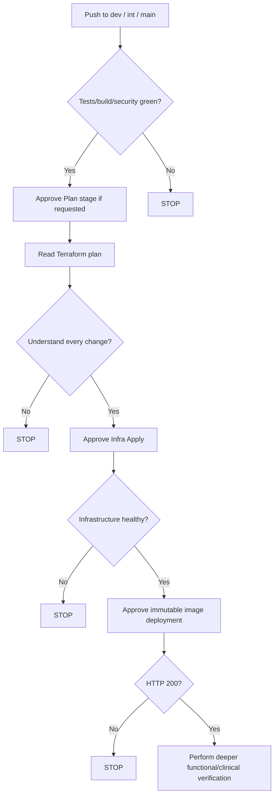

# Xhuma Deployment for Tired Humans

> [!IMPORTANT]
> **Unified Matrix Deployment:** All environments (Play, INT, PRD) deploy via `.github/workflows/matrix-deploy.yml` based on branch mappings in `infra/targets.json`:
> ```text
> feature/* → dev → int → main
>               │      │      │
>               ▼      ▼      ▼
>             Play    INT    PRD
> ```
> - Promotion across environments is strictly pull-request-based.
> - Brownfield environments (`INT` and `PRD`) enforce fail-closed existing-state/migration preflight guards (`require_existing_state = true`).
> - Target-specific Terraform state, immutable plan artefacts, digest-pinned container images, distinct approval gates, and guarded shared Key Vault network reconciliation apply across all environments.
> - Any unexpected destroy or replacement action is a STOP condition.

> The short version for when you need to deploy Xhuma without reading the entire Operator's Manual first.

> [!WARNING]
> This is a quick-start guide, not the authoritative technical runbook. If anything unexpected happens, stop and use the [Operator's Manual](./operators_manual.md).

---

## Before you touch anything

Check:
- you know which environment you are deploying (Play, INT, or PRD);
- you know which branch/commit should be deployed;
- you are looking at the newest workflow run;
- there are no older/stale runs waiting for approval;
- you are operating on the intended target environment.

**Golden rule:**
> If you don't understand why Terraform wants to change something, don't approve it.

---

## 1. Promote or merge the code

Promotion across environments is PR-based (`feature/*` → `dev` → `int` → `main`). Merging a PR into a deployment branch triggers the matrix deployment workflow (`.github/workflows/matrix-deploy.yml`) for the mapped target (`dev` → Play, `int` → INT, `main` → PRD).

Expected first stages:
- **Prepare Targets**
- **CI & Tests**
- **Build & Push**


*Figure 1 — CI & Tests stage confirming all tests pass before proceeding.*


*Figure 2 — Build & Push stage showing the immutable image build and Trivy vulnerability scan.*

- **Green** = continue.
- **Red** = stop and investigate.

---

## 2. GitHub may ask you to approve the Plan stage


*Figure 3 — Run #32 paused before `Infra Plan - play` because the `play-plan` GitHub Environment required reviewer approval.*


*Figure 4 — Plan-stage approval dialog — the operator explicitly selects `play-plan` and approves the protected environment before the workflow can continue.*

1. Click **View / Review deployments**;
2. Check `<target>-plan` (e.g. `play-plan`);
3. Confirm this is the correct run and target;
4. Select the environment and approve.

*(Note: Pre-plan approval reflects the protective configuration observed during the September 2026 Play rehearsal. It does not imply that every future environment must necessarily use a pre-plan approval gate).*

---

## 3. Terraform tells you what it wants to do

Headline summary: **X to add, Y to change, Z to destroy.**


*Figure 5 — Play rehearsal plan showing 0 add / 15 change / 0 destroy.*

- **Add** = new resources.
- **Change** = existing resources will be modified.
- **Destroy** = resources will be deleted.
- **`0 destroy` DOES NOT automatically mean safe.**

During the Play rehearsal, the plan initially looked harmless (0 add / 15 change / 0 destroy), but deeper inspection found Terraform intended to remove externally managed tags, Azure-managed metadata, and an existing subnet service endpoint. Apply was rightfully withheld and the configuration was corrected. 

*(Note: Run #35 convergence plan returned no infrastructure changes after the Terraform ownership corrections).*

---

## 4. Look at which resources are changing

The GitHub summary displays safe resource addresses/actions.

If further inspection is required, follow the complete procedure in the [Operator's Manual](./operators_manual.md).

A safe command to list resources and actions is:
```bash
terraform show -json <plan> | jq -r '
  .resource_changes[]
  | select(.change.actions != ["no-op"])
  | "\(.change.actions | join(" -> "))\t\(.address)"
'
```

> [!WARNING]
> Never paste or publish the complete Terraform JSON plan because it can contain sensitive configuration.

---

## 5. The second approval is the important one


*Figure 6 — Infrastructure Apply approval gate pausing at `rg-xhuma-play-infra` with plan hash and image digest visible.*

At this point:
- CI has passed;
- image has been built and scanned;
- Terraform Plan has completed and uploaded;
- the exact plan has an immutable SHA256 hash;
- Apply is **BLOCKED** pending your approval.

Before approving the target infrastructure environment (e.g. `rg-xhuma-play-infra`, `rg-xhuma-int-infra`, `rg-xhuma-prd-infra`), ask:
1. Is this the correct target?
2. Is this the correct commit and run?
3. Do I understand every infrastructure change?
4. Are there any unexpected deletes or replacements?
5. Is anything from other environments or shared infrastructure appearing unexpectedly?

**If any answer is wrong or unclear: STOP.**

---

## 6. Approve infrastructure

Only after the plan is fully understood.

Apply consumes the saved, reviewed immutable plan rather than silently generating a different one.


*Figure 7 — Successful infrastructure Apply job completing after strict plan review.*

---

## 7. Approve the application deployment

Infrastructure apply and application deployment are deliberately separate gates. The application is deployed using the immutable SHA-256 container digest built and scanned earlier.


*Figure 8 — Immutable application deployment using exact SHA256 digest.*

Approve the `<target>-app` gate (e.g. `play-app`, `int-app`, `prd-app`) to release the container to App Service.

---

## 8. Ask the application if it is alive

Verify process liveness:

```bash
curl -sS \
  -o /tmp/xhuma-health.json \
  -w 'HTTP %{http_code}\n' \
  https://<app_service>.azurewebsites.net/health

cat /tmp/xhuma-health.json
```

Expected output:
```json
HTTP 200
{"status":"ok"}
```


*Figure 9 — Successful HTTP 200 health check.*

**HTTP 200 means Xhuma is alive. It does NOT prove:**
- GP Connect works;
- SOAP/mTLS works;
- Audit persistence is complete;
- Every downstream NHS dependency works;
- Clinical acceptance is complete.

---

## 9. Environment onboarding before external connectivity

- [ ] Custom domain bound and Secured
- [ ] DNS verification record retained permanently
- [ ] `epic-ca-cert` populated in Local Key Vault
- [ ] Key Vault reference status is `Resolved`
- [ ] `ALLOWED_HOSTS` configured appropriately
- [ ] Relay endpoint configured
- [ ] Health checked over intended custom FQDN
- [ ] SOAP/mTLS synthetic clinical request tested from clinical workstation

*(Refer to the [Operator's Manual](./operators_manual.md) for full verification steps).*

---

## 10. If something breaks

Simple rules:
- **Don't** randomly mutate Azure until you know why it failed.
- **Don't** generate a different Terraform plan and pretend it is the reviewed one.
- **Don't** approve unexplained drift.
- **Don't** expose secrets in screenshots or logs.
- **Don't** delete the target resource group because it contains Terraform state and backend storage.
- **If unsure, stop and use the full [Operator's Manual](./operators_manual.md).**

---

## 11. The 30-Second Fast-Path



> **Tired-person rule:** stopping a deployment is reversible. Approving a change you don't understand may not be.

---
*For authoritative procedures, refer to the [Operator's Manual](./operators_manual.md).*
