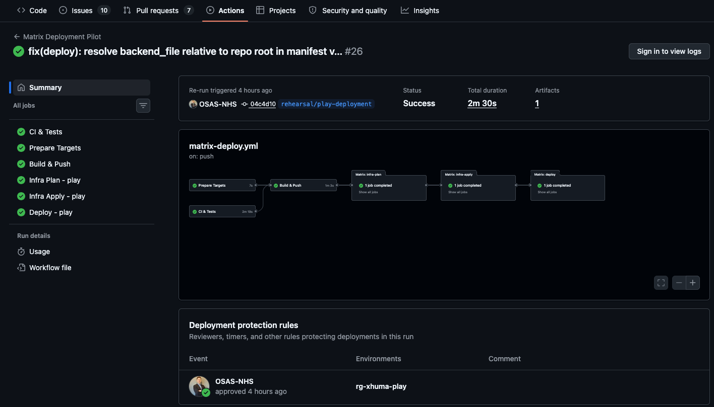

# Xhuma Operator's Manual

This manual is the authoritative operational guide for deploying, configuring, verifying, and troubleshooting Xhuma across all target environments (Play, INT, PRD).

For quick deployment guidance, see [Xhuma Deployment for Tired Humans](deployment_for_tired_humans.md).  
For the 20-query KQL diagnostics library, see the [Observability & Diagnostics Guide](observability.md).

---

## Table of Contents

- [Operational Responsibility Boundary](#operational-responsibility-boundary)
  - [Responsibility Matrix](#responsibility-matrix)
  - [Core Assurance Distinctions](#core-assurance-distinctions)
- [1. Environment Architecture & Promotion Model](#1-environment-architecture--promotion-model)
  - [Target Mapping and Resources](#target-mapping-and-resources)
- [2. Infrastructure Bootstrapping and State Storage](#2-infrastructure-bootstrapping-and-state-storage)
  - [2.1 Bootstrapping Procedure](#21-bootstrapping-procedure)
- [3. Azure Service Principal & Permissions](#3-azure-service-principal--permissions)
- [4. Setting Up Variables and GitHub Environments](#4-setting-up-variables-and-github-environments)
  - [4.1 Matrix Deployment Workflow](#41-matrix-deployment-workflow)
- [5. Key Vault Population](#5-key-vault-population)
- [6. Deployment Orchestration and Review Gates](#6-deployment-orchestration-and-review-gates)
  - [6.1 Continuous Integration and Build Controls](#61-continuous-integration-and-build-controls)
  - [6.2 First Deployment & Protected Plans](#62-first-deployment--protected-plans)
  - [6.3 Terraform Plan Review Before Approval](#63-terraform-plan-review-before-approval)
  - [6.4 Plan Retries & Image Deployment](#64-plan-retries--image-deployment)
  - [6.5 Digest Rollback & Recovery Controls](#65-digest-rollback--recovery-controls)
- [7. Verification and Health Checks](#7-verification-and-health-checks)
  - [7.1 Safe Verification Boundaries](#71-safe-verification-boundaries)
  - [7.2 Post-Deployment Health Verification](#72-post-deployment-health-verification)
  - [7.3 Key Vault Reference Verification](#73-key-vault-reference-verification)
  - [7.4 HSCN Relay Observability & Diagnostics](#74-hscn-relay-observability--diagnostics)
- [8. Shared Infrastructure Adoption (Terraform)](#8-shared-infrastructure-adoption-terraform)
- [9. Operational Observability & Shared Query Pack](#9-operational-observability--shared-query-pack)
  - [9.1 Shared Azure Monitor Query Pack](#91-shared-azure-monitor-query-pack)
  - [9.2 Key Operational Boundaries](#92-key-operational-boundaries)
  - [9.3 How to Run Queries](#93-how-to-run-queries)
- [10. dm+d Cache Warmer Operations and Diagnostics](#10-dmd-cache-warmer-operations-and-diagnostics)
  - [10.1 Operational State Across Environments](#101-operational-state-across-environments)
  - [10.2 Terminology Publication Schedule & Operational Timing](#102-terminology-publication-schedule--operational-timing)
  - [10.3 Release-Freshness Operational Caveat](#103-release-freshness-operational-caveat)
  - [10.4 Scheduler State & Manual Triggering](#104-scheduler-state--manual-triggering)
  - [10.5 Proven Safety Invariants](#105-proven-safety-invariants)
  - [10.6 Trigger Manual Job Execution](#106-trigger-manual-job-execution)
  - [10.7 Check Execution Status & Logs](#107-check-execution-status--logs)
  - [10.8 Operational Failure Modes and Recovery](#108-operational-failure-modes-and-recovery)
  - [10.9 First-Environment Warmer Commissioning Sequence](#109-first-environment-warmer-commissioning-sequence)
- [11. Quick Operator Commands](#11-quick-operator-commands)
- [12. Assurance and Evidence Records](#12-assurance-and-evidence-records)

---

## Operational Responsibility Boundary

Xhuma provides the application, infrastructure-as-code, and observability controls implemented in this repository. Deployment-specific operational arrangements are defined by the local deploying organisation's operating model, including:
- **Support Hours & Coverage:** The local organisation determines operational support hours (e.g. core business hours vs extended coverage); Xhuma does not encode a 24/7 or continuous human monitoring service.
- **Alert Recipients & Action Groups:** Xhuma provisions telemetry emitters and metric alert primitives. Notification routing, alert destinations, and Azure Monitor Action Groups are supplied by the operator.
- **Escalation Routes & Paging:** Incident triage, on-call rotas, paging policies, and escalation paths are defined by the local organisation's IT service management procedures.
- **Incident Management:** Severity classification, communication channels, major incident handling, and post-incident reviews belong to the deploying entity.
- **Service Ownership & Access Groups:** Azure RBAC assignments, Microsoft Entra ID security groups, key vault access approval, and repository access control are managed under local organizational governance.

### Responsibility Matrix

| Xhuma Provides (Repository Controls) | Operator Configures (Local Operating Model) |
| :--- | :--- |
| **Structured Application Telemetry** (OpenTelemetry traces, metrics, structured logs) | Log Analytics workspace data retention, daily cap, and ingestion policies |
| **Azure Monitor & Application Insights Integration** | Environment access controls, Azure RBAC assignments, and log access permissions |
| **Standardised Diagnostic Query Pack** (`xhuma-operational-diagnostics`, 20 KQL queries) | Authorised operator access, query execution, and diagnostic triage workflows |
| **dm+d Scheduler Failure Alert Resources** (`RunsFailed`, `TriggersFailed` metric alerts) | Azure Monitor Action Groups (`dmd_cache_alert_action_group_ids`), notification channels, and on-call routing |
| **Coarse Process Liveness Endpoint** (`/health` returning `{"status":"ok"}`) | External synthetic monitoring probes, clinical uptime alerting, and end-to-end synthetic checks |
| **Deployment Safety Gates** (linting, pytest, Trivy scans, plan hashing, drift fail-closed checks) | GitHub Environment protection policies, designated human plan/apply reviewers, and change advisory processes |
| **Digest Rollback Commands & Image Manifests** | Support hours, rollback authorisation, escalation routes, and incident response procedures |
| **Immutable PostgreSQL Audit Trail Persistence** | Audit log review cadence, regulatory compliance audits, and long-term retention policies |

### Core Assurance Distinctions

To ensure audit safety under NHS England and SCAL assurance frameworks, operators and auditors must preserve these distinctions:

1. **Query Pack != Alerting System:** The shared diagnostic Query Pack (`xhuma-operational-diagnostics`) provides 20 pre-written KQL query definitions for interactive troubleshooting. It is **not** an automated alerting system; it does not evaluate conditions continuously, trigger pages, or route incident notifications.
2. **`/health` != End-to-End Clinical Readiness:** The `/health` endpoint is unauthenticated and returns a coarse HTTP 200 process-liveness signal confirming that the Python Uvicorn worker is running. It does **not** probe Spine connectivity, SDS directory routing, GP Connect reachability, Redis cache contents, or mTLS certificate validity.
3. **Scheduler Failure Alerts != Release-Freshness Watchdog:** The Terraform-supported metric alerts (`la_runs_failed`, `la_triggers_failed`) trigger only when an automated Logic App execution or trigger reports an infrastructure failure. They do **not** verify whether NHS England published an expected new release or whether the cached data is fresh.
4. **`warm_succeeded` != Proof of New Weekly Release:** A `warm_succeeded` event confirms that the warmer completed a technical caching cycle for the terminology release visible at runtime. If upstream release publication was delayed, `warm_succeeded` may reflect re-warming of the existing active release.
5. **Telemetry Instrumentation != Active Human Monitoring:** Xhuma instruments code paths and emits telemetry to Azure Monitor / Application Insights. Emitting telemetry does not imply active human surveillance, 24/7 monitoring, or an active network operations centre.
6. **Rollback Controls != Formal Disaster-Recovery Service:** The container digest rollback procedure provides tactical operational recovery from a defective container deployment. It is not an enterprise business continuity, geo-redundant failover, or disaster-recovery service.

---

## 1. Environment Architecture & Promotion Model

Xhuma operates a strict pull-request-based promotion model. Code merges into branch streams, triggering automated matrix deployment pipelines (`.github/workflows/matrix-deploy.yml`):

```text
feature/* ──> dev ──(PR)──> int ──(PR)──> main
               │             │             │
               ▼             ▼             ▼
             Play           INT           PRD
```

Each deployment run builds and scans an immutable container image tagged by commit SHA and referenced by its immutable SHA-256 digest (`ghcr.io/uclh-digital-innovation-hub/xhuma@sha256:...`). Each target deployment uses the exact immutable digest produced, reviewed, and verified for that deployment run.

### Target Mapping and Resources

| Git Branch | Target Name | Configuration / State Files | Authoritative Workflow |
| :--- | :--- | :--- | :--- |
| `dev` | **Play** | `infra/backends/play.hcl`, `infra/env/play.tfvars` | `.github/workflows/matrix-deploy.yml` |
| `int` | **INT** | `infra/backends/int.hcl`, `infra/env/int.tfvars` | `.github/workflows/matrix-deploy.yml` |
| `main` | **PRD** | `infra/backends/prd.hcl`, `infra/env/prd.tfvars` | `.github/workflows/matrix-deploy.yml` |

- **Target-Local Resources:** Each environment receives a dedicated Azure App Service for containers, target-isolated VNet and subnets, target-local Managed Redis, target-local PostgreSQL audit database, target-local Key Vault, and target-local Log Analytics / Application Insights workspace.
- **Shared Resources:** The shared Xhuma Azure services scope hosts services with independent lifecycles, such as the Public JSON Web Key Set (JWKS) via Blob Storage and the Shared Key Vault for NHS-wide API keys, signing keys, and dm+d credentials.

---

## 2. Infrastructure Bootstrapping and State Storage

Terraform state and reviewed execution plans are stored securely in Azure Blob Storage. Each target has its own storage account within its target-local resource group.

### 2.1 Bootstrapping Procedure
The target-agnostic setup script establishes the backend storage:

1. **Target Configuration**: Verify target definitions in `infra/targets.json` and backend coordinates in `infra/backends/<target>.hcl`.
2. **Execution**: The `matrix-deploy.yml` workflow automatically runs the bootstrap script:
   ```bash
   export AZURE_SUBSCRIPTION_ID="<target-subscription-id>"
   export AZURE_TENANT_ID="<target-tenant-id>"
   export XHUMA_BACKEND_FILE="infra/backends/play.hcl"
   bash infra/bootstrap/setup-target.sh
   ```
   This provisions the state storage account and blob containers in the target resource group. The `tfplans` container automatically expires files after 7 days to prevent unbounded plan retention.

*(Note: Entra Blob authentication and OIDC are scheduled as subsequent hardening changes. We currently use interim storage-key authentication and Service Principal credentials.)*

---

## 3. Azure Service Principal & Permissions

To allow GitHub Actions to deploy infrastructure and code, Xhuma relies on Azure deployment credentials:

1. **Target Resource Group Permissions**: The deployment identity requires Contributor and User Access Administrator (or scoped RBAC equivalent) over the target Azure Resource Group and state backend.
2. **Shared Key Vault Access Prerequisite**: The Terraform configuration manages network access rules and access policies on the shared Key Vault. The deployment identity requires sufficient rights to manage these network rules and policies.
3. **Authentication Secrets**: Deployment authentication inputs are provided via repository secrets:
   - `AZURE_CLIENT_ID`
   - `AZURE_CLIENT_SECRET`
   - `AZURE_TENANT_ID`
   - `AZURE_SUBSCRIPTION_ID`
   Ensure credentials are periodically rotated before expiry.

---

## 4. Setting Up Variables and GitHub Environments

### 4.1 Matrix Deployment Workflow

Deployments rely on GitHub Environments to provide controlled stages between Plan generation, Infrastructure Apply, and Application Deployment.


*Figure 1 — Plan review gate in the Matrix Deployment Pilot.*

**Deployment Environment Stages:**

| Stage | Environment Name Pattern | Reviewer / Policy Action |
| :--- | :--- | :--- |
| **Plan Stage** | `<target>-plan` (e.g. `play-plan`) | Plan executes under the target's plan environment. A plan-stage approval may occur depending on current GitHub Environment protection policy. (Repository-managed configuration alone does not prove human reviewers are configured on all plan environments). |
| **Infra Apply Gate** | Configured target infrastructure approval environment (e.g. `<target infrastructure approval environment>`) | Review plan summary, inspect attribute paths, verify zero unexplained destruction, and approve apply. |
| **App Deploy Gate** | Configured target deployment environment (e.g. `<target application deployment environment>`) | Review scanned image digest and approve container deployment. |

**Actual Deployment Sequence from `matrix-deploy.yml`:**

1. **CI & Tests (`ci`):** Executes Ruff linting, formatting checks, and pytest suite with coverage.
2. **Build & Scan (`build`):** Builds the container image, tags it with the source commit SHA, and scans it using Trivy for `HIGH` and `CRITICAL` vulnerabilities. Outputs the immutable image digest.
3. **Target Selection (`prepare-targets`):** Validates `infra/targets.json` against schema and determines the active matrix targets for the triggered branch.
4. **Infra Plan (`infra-plan`):** Runs under the target's plan environment (`<target>-plan`). Checks existing state preflight for brownfield targets, runs `terraform init`, generates a saved plan, uploads the plan blob to storage, computes its SHA-256 hash, and emits summary diagnostics. Unexplained destructive actions on existing state targets trigger a fail-closed STOP condition.
5. **Infra Apply (`infra-apply`):** Runs under the configured target infrastructure approval environment after approval. Downloads the exact manifest and plan, cryptographically verifies the SHA-256 plan hash against the manifest, runs `terraform apply`, reconciles shared Key Vault network rules via `guard_shared_plan.py`, refreshes App Service Key Vault references, and validates reference resolution.
6. **Application Deployment (`deploy`):** Runs under the configured target deployment environment after approval. Deploys the candidate container pinned to the immutable SHA-256 digest produced by the build stage, verifies the deployed digest on App Service, and checks application process liveness via `/health`.

---

## 5. Key Vault Population

Infrastructure and application liveness can be established before the target-local Epic CA is populated. However, `epic-ca-cert` is required before Epic/SOAP/mTLS functional acceptance.

1. `epic-ca-cert`: The target-specific Epic verification CA bundle required by application semantics (Base64 PEM) used for mutual TLS (mTLS). It may contain the direct issuing intermediate(s).
2. **Populating the Vault**: Use the Azure Portal or CLI to add the secret to the provisioned Local Key Vault:
   ```bash
   az keyvault secret set \
     --vault-name "<target-key-vault>" \
     --name "epic-ca-cert" \
     --file /path/to/epic-ca-bundle.pem
   ```
   *Note: Ensure multi-line PEM files are formatted correctly (valid Base64 or standard PEM with preserved newlines).*

---

## 6. Deployment Orchestration and Review Gates

The unified deployment workflow (`.github/workflows/matrix-deploy.yml`) is the single authoritative deployment path for all environments. The legacy workflows (`infra.yml` and `cd.yml`) have been decommissioned.

### 6.1 Continuous Integration and Build Controls

Before any deployment plan is generated, the pipeline enforces strict quality and security gates:


*Figure 2 — CI & Tests stage confirming all tests pass before proceeding.*


*Figure 3 — Build & Push stage showing the immutable image build and Trivy vulnerability scan.*

### 6.2 First Deployment & Protected Plans

1. **Trigger**: Merge an approved pull request into the mapped branch (`dev` for Play, `int` for INT, `main` for PRD) following the promotion sequence `feature/*` → `dev` → `int` → `main`.
2. **Plan Generation**: The workflow generates a Terraform plan and securely uploads it to the `tfplans` container in Azure Storage. Only a non-secret plan hash and summary are published in GitHub.
3. **Review & Approval**: An authorized operator reviews the plan summary in GitHub (and the full plan in Azure Storage if necessary) using the inspection procedure below, then approves the configured target infrastructure environment.

### 6.3 Terraform Plan Review Before Approval

When reviewing an immutable saved plan for approval, operators must follow this complete procedure to prevent accidental disruption and avoid exposing sensitive state data.

#### Explicit STOP Conditions
Do NOT approve the infrastructure apply gate if any of the following occur:

| Check | Failure Condition (STOP Immediately) |
| :--- | :--- |
| **Unexpected Deletions** | `destroy > 0` on persistent data stores (PostgreSQL, Redis, Storage). |
| **Resource Replacement** | An existing resource is marked for replacement (`-/+`) rather than in-place update (`~`). |
| **Shared Resource Drift** | Shared Key Vault policies or network rules show unexplained modifications or removals. |
| **Target Isolation Violation** | Plan modifies resources outside the target's explicit scope. |
| **Unverified Digest** | Application container image does not match the immutable SHA-256 digest built in the preceding CI stage. |
| **Brownfield State Adoption** | Migration guard fails or detects unexpected recreate actions on state-adopted targets. |

#### Safe Plan Inspection Procedure
If a plan contains unexpected changes, download and inspect the JSON representation safely:

```bash
# 1. Download the plan file from Azure Storage
az storage blob download \
  --account-name "<target-storage-account>" \
  --container-name tfplans \
  --name "<plan-blob-name>.tfplan" \
  --file /tmp/plan.tfplan \
  --auth-mode key

# 2. Convert to JSON
cd infra
terraform show -json /tmp/plan.tfplan > /tmp/plan.json

# 3. Inspect actions per resource
jq -r '.resource_changes[] | "\(.change.actions | join(","))\t\(.address)"' /tmp/plan.json

# 4. Deep attribute inspection for modified resources
jq -r '
  .resource_changes[]
  | select(.change.actions != ["no-op"])
  | .address as $addr
  | (.change.before // {}) as $before
  | (.change.after // {}) as $after
  | ([($before | paths(scalars)), ($after | paths(scalars))] | unique[]) as $p
  | select(($before | getpath($p)) != ($after | getpath($p)))
  | "\($addr)\t\($p | map(tostring) | join("."))"
' /tmp/plan.json
```

> **Example (Play Rehearsal Drift Detection):**  
> A superficially safe plan showed: `0 to add, 15 to change, 0 to destroy`.  
>  
>   
> *Figure 4 — Play rehearsal plan showing 0 add / 15 change / 0 destroy. Further inspection revealed unexplained drift and Apply was withheld.*  
>  
> Attribute-path inspection revealed that Terraform intended to remove externally-managed organisational tags and Application Insights hidden links. Apply was withheld, and Terraform configuration was corrected via `ignore_changes`.


*Figure 5 — Clean plan with 0 changes following drift reconciliation.*

### 6.4 Plan Retries & Image Deployment


*Figure 6 — Successful infrastructure Apply job completing after manual approval.*

1. **Plan Retries & Expiry**: If the apply step fails, it can be retried and will re-download the exact same reviewed plan blob securely. Plans expire automatically after 7 days in Blob Storage. If a plan is no longer valid, a new workflow run must be triggered.
2. **Image Deployment**: The pipeline deploys the exact scanned Docker image digest verified during the build stage. This step executes under the target application deployment environment.


*Figure 7 — Application image deployed deterministically using exact immutable SHA-256 digest.*

### 6.5 Digest Rollback & Recovery Controls

1. **Recovery Ownership**: If a deployment introduces regressions, authorized operators can perform a rollback. Digest rollback provides tactical container recovery for defective deployments; it is not an enterprise disaster-recovery or database point-in-time recovery service.
2. **Rollback Procedure**:
   - Identify the previous known-good digest from the deployment step summary.
   - Manually redeploy the previous digest via Azure CLI:
     ```bash
     az webapp config container set \
       --name <target-app-service> \
       --resource-group <target-resource-group> \
       --docker-custom-image-name ghcr.io/uclh-digital-innovation-hub/xhuma@sha256:<previous-digest>
     ```
   - **PostgreSQL Compatibility Notice:** Reverting the container digest does **not** revert database schema migrations. Rollback is only safe when the previous application release is compatible with the current Alembic schema.

---

## 7. Verification and Health Checks

### 7.1 Safe Verification Boundaries
- **Liveness Probe**: The `/health` endpoint is unauthenticated and returns a coarse HTTP 200 process-liveness signal: `{"status":"ok"}`. It does not perform downstream NHS requests or leak credentials.
- **Process Liveness vs Clinical Readiness:** HTTP 200 on `/health` proves coarse application process liveness only. It does **not** prove end-to-end clinical readiness (e.g. Spine connectivity, valid mTLS certificates, or populated cache keys).
- **Manual Clinical Check**: Because GitHub Actions runners lack clinical mTLS certificates, a manual synthetic check must be performed from a trusted clinical workstation to verify SOAP mTLS, SAML validation, and audit persistence.

### 7.2 Post-Deployment Health Verification

Run this reproducible command to verify application process liveness:

```bash
curl -sS \
  -o /tmp/xhuma-health.json \
  -w 'HTTP %{http_code}\n' \
  https://<target-app-service>.azurewebsites.net/health

cat /tmp/xhuma-health.json
```


*Figure 8 — Post-deployment liveness verification: App Service returned HTTP 200 with `{"status":"ok"}`.*

### 7.3 Key Vault Reference Verification

Listing App Service settings containing `@Microsoft.KeyVault(...)` does **not** prove the references are resolved. Verify actual resolution status without exposing secret values using the Azure App Service configuration references status endpoint:

```bash
az rest --method get \
  --uri "https://management.azure.com/subscriptions/<target-subscription-id>/resourceGroups/<target-resource-group>/providers/Microsoft.Web/sites/<target-app-service>/config/configreferences/appsettings?api-version=2022-03-01" \
  --query "value[].{name:name, status:properties.status, vault:properties.vaultName}" \
  -o table
```

**Verification Sequence:**
1. Confirm App Service managed identity exists.
2. Confirm access policy on shared vault (`Get`, `List` secrets).
3. Confirm target-local subnets (App Service and Container Apps warmer) are admitted by shared vault network rules.
4. Confirm every required reference reports `status: "Resolved"`.
5. **STOP** if status reports `AccessToKeyVaultDenied`, `SecretNotFound`, or any status other than `Resolved`.

### 7.4 HSCN Relay Observability & Diagnostics

The WebSocket relay hub consumes and sanitises client-side diagnostics (`relay_logs`) attached by the HSCN relay client:
- Emitted with prefix `relay_diag <json>` into standard Application Insights traces.
- `outcome = "ok"` proves relay transport succeeded; an HTTP 500 can still be an upstream application failure.
- `outcome = "upstream_error"` indicates communication failure between relay and upstream Spine / GP practice.
- `outcome = "blocked"` indicates firewall, proxy, or mTLS authorization failure.

---

## 8. Shared Infrastructure Adoption (Terraform)

The shared Key Vault is adopted into a separate shared Terraform state. The matrix workflow automatically:
- Reads the current shared Key Vault network ACL;
- Preserves existing rules;
- Admits target-local subnets required by deployed components, including:
  - App Service integration subnet
  - Container Apps warmer subnet when the warmer is enabled;
- Guards the shared plan with `guard_shared_plan.py` to fail closed if unexpected changes are proposed;
- Verifies required subnets are present post-apply.

---

## 9. Operational Observability & Shared Query Pack

### 9.1 Shared Azure Monitor Query Pack

Operational diagnostics across Play, INT, and PRD are standardised through a shared Azure Monitor Query Pack:

| Property | Value |
| :--- | :--- |
| **Resource Name** | `xhuma-operational-diagnostics` |
| **Location** | The shared Xhuma Azure services scope |
| **Type** | `Microsoft.OperationalInsights/queryPacks` |
| **Full Catalogue & Guide** | [Observability & Diagnostics Guide](observability.md) |
| **Reference Export** | [Query Pack Reference Snapshot](../reference/xhuma-operational-diagnostics-querypack.json) |

### 9.2 Key Operational Boundaries
1. **Stores Queries, Not Telemetry:** The Query Pack stores KQL query definitions only; it does not store logs, aggregate telemetry, or create an extra Log Analytics Workspace.
2. **Scoping:** The exact same queries are executed in the context of the target environment's Log Analytics Workspace or Application Insights component.
3. **RBAC Isolation:** Access to the Query Pack and access to underlying telemetry are separate. An operator must have reader permissions on the target resource group to view telemetry.
4. **Diagnostic Tool != Alerting System:** The Query Pack is an on-demand investigative tool for interactive troubleshooting. It does not actively evaluate alerts, page operators, or route incident notifications. Notification routing, escalation, and incident response procedures are local operator responsibilities.

### 9.3 How to Run Queries
1. Open the [Azure Portal](https://portal.azure.com).
2. Navigate to the target resource group (`<play-resource-group>`, `<int-resource-group>`, or `<prd-resource-group>`).
3. Open the target's **Log Analytics Workspace** or **Application Insights** instance.
4. Click **Logs**, open **Query Packs**, and select `xhuma-operational-diagnostics`.
5. Run the required diagnostic query. See [Observability & Diagnostics](observability.md) for the complete 20-query catalogue and symptom decision matrix.

---

## 10. dm+d Cache Warmer Operations and Diagnostics

The dm+d cache warmer operates as a target-local Azure Container Apps Job (`azurerm_container_app_job.dmd_warm`) provisioned with a **manual trigger configuration**. It pre-populates target-local Redis DB 2 with resolved `DMDConcept` representations so clinical prescription conversions execute with low-millisecond target-local Redis lookups.

### 10.1 Operational State Across Environments

| Environment | Current Implemented State | Required v1.0 Operational Baseline |
| :--- | :--- | :--- |
| **Play** | Warmer infrastructure enabled (`dmd_cache_warm_enabled = true`); scheduler disabled. | Warmer infrastructure enabled; manual execution operational. |
| **INT** | Warmer infrastructure currently disabled by target configuration/default; scheduler disabled. | **Warmer infrastructure MUST be explicitly enabled** (`dmd_cache_warm_enabled = true` in INT target tfvars). |
| **PRD** | Warmer infrastructure currently disabled by target configuration/default; scheduler disabled. | **Warmer infrastructure MUST be explicitly enabled** (`dmd_cache_warm_enabled = true` in PRD target tfvars). |

> [!IMPORTANT]
> **v1.0 Implementation Note:** The warmer is standard target-local operational infrastructure for INT and PRD in v1.0. Enabling it must occur via explicit per-target tfvars configuration (`dmd_cache_warm_enabled = true` in `infra/env/int.tfvars` and `infra/env/prd.tfvars`), **not** by changing the global Terraform default to true.

### 10.2 Terminology Publication Schedule & Operational Timing

- **Project Operational Assumption:** Refreshed upstream dm+d releases are normally expected to become available at approximately **04:00 UK local time on Monday** via the NHS Terminology Server. This is a project operational planning assumption based on observed release operations, **not** an externally guaranteed NHS SLA. Occasional small publication delays can occur.
- **Xhuma Warm Target:** Xhuma targets warming at approximately **05:00 UK local time on Monday**, providing around one hour of publication headroom.
- **DST-Aware Recurrence:** Azure recurrence uses `GMT Standard Time`, maintaining UK local timing across GMT and BST.
- **No Cache Purge:** Xhuma operates strictly on the model:
  $$\text{discover} \longrightarrow \text{warm} \longrightarrow \text{verify} \longrightarrow \text{activate} \longrightarrow \text{retire naturally by TTL}$$
  New release keys are versioned (`dmd:resolved:v1:<release>:<concept_id>`). The active release pointer (`dmd:active-release`) is atomically updated only after full verification. The prior release is not destructively deleted; old keys expire naturally under their 9-day TTL. **Never describe normal dm+d operation as a "purge".** `FLUSHDB` and wildcard `KEYS *` are strictly prohibited.

### 10.3 Release-Freshness Operational Caveat

> [!WARNING]
> **Release-Freshness Limitation:**  
> The current warmer implementation discovers whatever upstream release is visible at execution time. It does **not** currently require the discovered release to differ from the already-active release before completing a successful warm.  
> Therefore:
> - A `warm_succeeded` event proves a technically successful complete warm.
> - It does **NOT** by itself prove that the newly expected weekly release was visible upstream.
> - If upstream publication were delayed beyond the scheduled run, Xhuma could successfully re-warm the previous release.
>
> Future scheduler/watchdog acceptance must verify:
> 1. Job success
> 2. Cache completeness
> 3. Zero evictions
> 4. Active pointer health
> 5. Expected release freshness/advancement where a new release is due

### 10.4 Scheduler State & Manual Triggering

- **Scheduler Implementation:** The automated Azure Logic App scheduling path exists in Terraform (`infra/main.tf`), but `dmd_cache_schedule_enabled` is **deliberately blocked by fail-closed assertions** (`condition = !var.dmd_cache_schedule_enabled`) pending acceptance of the missed-success/freshness watchdog. Automated scheduling is not active in any environment.
- **Scheduler Alerting Primitives:** The Terraform implementation supports Azure Monitor alerts for failed scheduler runs/triggers (`azurerm_monitor_metric_alert.la_runs_failed` and `la_triggers_failed`) when scheduling is enabled and an operator-supplied Action Group is configured (`dmd_cache_alert_action_group_ids`). Alert destinations and notification routing are operator-supplied configurations.
- **Warmer Infrastructure Enabled != Scheduler Enabled:** The Container Apps Job remains manually triggerable via CLI or Azure Portal even when automatic recurrence is disabled.

### 10.5 Proven Safety Invariants

1. **Job Execution Timeout:** 1800 seconds (`replica_timeout_in_seconds = 1800`).
2. **Zero Replica Retries:** `replica_retry_limit = 0`. Platform retries are prohibited to prevent colliding with the held distributed lock.
3. **Scheduler Polling Envelope:** 2100 seconds (`local.dmd_logic_poll_timeout_seconds = 2100`).
4. **Distributed Warmer Lock TTL:** 2700 seconds (`local.dmd_lock_ttl_seconds = 2700`, acquired at `dmd:warm:v1:lock`).
5. **Strict Timeout Hierarchy:** $1800\text{s (job)} < 2100\text{s (poll)} < 2700\text{s (lock)}$.
6. **Dedicated Digest-Pinned Image:** Job runs the immutable digest (`var.dmd_cache_job_image`).
7. **Runtime Key Vault Credential Resolution:** Resolves dm+d credentials at runtime from the shared Key Vault via user-assigned managed identity.
8. **Redis Memory Safety Preflight:** Aborts before writes if current memory + projected delta with 1.5x multiplier exceeds 80% of `maxmemory`.
9. **Zero Eviction Tolerance:** Aborts immediately if `evicted_keys` increases by even 1 key during warming.
10. **Grace Period Coexistence:** 9-day data TTL vs 8-day active pointer TTL provides a 24-hour grace window during schedule delays.
11. **Prohibited Commands:** `FLUSHDB` and wildcard `KEYS *` are strictly forbidden.

### 10.6 Trigger Manual Job Execution

```bash
az containerapp job start \
  --name <target-app-service>-dmd-warm \
  --resource-group <target-resource-group>
```

### 10.7 Check Execution Status & Logs

```bash
# List executions
az containerapp job execution list \
  --name <target-app-service>-dmd-warm \
  --resource-group <target-resource-group> \
  -o table

# Query logs in Log Analytics
az monitor log-analytics query \
  --workspace "$LAW_ID" \
  --analytics-query '
ContainerAppConsoleLogs_CL
| where ContainerJobName_s == "<target-app-service>-dmd-warm"
| where TimeGenerated > ago(2h)
| project TimeGenerated, Log_s
| order by TimeGenerated desc
' \
  -o table
```

### 10.8 Operational Failure Modes and Recovery

1. **What a failed warm means:**
   - Active release pointer (`dmd:active-release`) remains untouched, pointing to the prior release.
   - The prior release data remains valid for up to 9 days (providing a grace window).
   - A warmer failure leaves the previous active release available and preserves the existing on-demand terminology fallback path. It does not guarantee subsequent clinical conversion if downstream terminology dependencies are also unavailable.
2. **Instance-Wide Redis Memory Safety:**
   - Redis `maxmemory` and eviction policies are instance-wide across all logical databases (DB 0 application, DB 1 PDS, DB 2 dm+d).
   - Preflight checks and zero-eviction guards prevent dm+d warming from evicting active PDS cache or application session keys.

### 10.9 First-Environment Warmer Commissioning Sequence

When commissioning the warmer for the first time in an environment (or verifying a re-commissioned target), execute this strict 12-step verification sequence:

1. **Review infrastructure plan:** Inspect the target Terraform plan enabling the warmer infrastructure.
2. **Verify expected additive infrastructure only:** Confirm that the plan proposes only additive Container Apps Environment, Container Apps Job, and user-assigned managed identity resources with zero destructive changes.
3. **Run warmer dry-run/preflight:** Trigger the preflight command or inspect memory capacity.
4. **Require `CLEARED TO WARM`:** Ensure Redis memory headroom satisfies the 80% ceiling requirement.
5. **Execute one manual warm:** Trigger the Container Apps Job manually via `az containerapp job start`.
6. **Verify successful completion:** Confirm the Job execution finishes with status `Succeeded`.
7. **Verify zero evictions:** Confirm Redis `evicted_keys` delta is exactly 0.
8. **Verify active release pointer:** Confirm `dmd:active-release` points to the expected discovered release (e.g. `202610.1.0`).
9. **Verify distributed lock released:** Confirm `dmd:warm:v1:lock` is no longer held.
10. **Verify direct resolved-cache read:** Probe a resolved concept key in Redis DB 2 to confirm data presence.
11. **Verify a real application path produces a resolved terminology cache hit:** Execute an ITI-38 document conversion request and verify telemetry records a cache hit without an outbound HTTP call to the NHS Terminology Server.
12. **Only then consider automated recurrence commissioning:** Do not enable automated scheduler recurrence until all preceding steps succeed and freshness watchdog monitoring is accepted.

---

## 11. Quick Operator Commands

Use these safe generic commands to inspect environments. Replace placeholders with actual environment values.

- **Current Azure subscription:**
  ```bash
  az account show --query name -o tsv
  ```
- **App Service managed identity:**
  ```bash
  az webapp identity show --name <target-app-service> --resource-group <target-resource-group> --query principalId -o tsv
  ```
- **SHA-256 plan verification:**
  ```bash
  sha256sum <target>-plan.tfplan
  ```
- **Changed Terraform resources/actions:**
  ```bash
  terraform show -json <target>-plan.tfplan | jq '.resource_changes[] | {address, actions: .change.actions}'
  ```
- **Changed Terraform attribute paths:**
  ```bash
  terraform show -json <target>-plan.tfplan | jq -r '
    .resource_changes[]
    | select(.change.actions != ["no-op"])
    | .address as $addr
    | (.change.before // {}) as $before
    | (.change.after // {}) as $after
    | ([($before | paths(scalars)), ($after | paths(scalars))] | unique[]) as $p
    | select(($before | getpath($p)) != ($after | getpath($p)))
    | "\($addr)\t\($p | map(tostring) | join("."))"
  '
  ```
- **App Service process liveness:**
  ```bash
  curl -s https://<target-app-service>.azurewebsites.net/health
  ```
- **Key Vault reference resolution status (safe):**
  ```bash
  az rest --method get \
    --uri "https://management.azure.com/subscriptions/<target-subscription-id>/resourceGroups/<target-resource-group>/providers/Microsoft.Web/sites/<target-app-service>/config/configreferences/appsettings?api-version=2022-03-01" \
    --query "value[].{name:name, status:properties.status, vault:properties.vaultName}" \
    -o table
  ```
- **Currently deployed container digest:**
  ```bash
  az webapp config show --name <target-app-service> --resource-group <target-resource-group> --query 'linuxFxVersion' -o tsv
  ```
- **Workflow run inspection:**
  ```bash
  gh run view <run-id>
  ```

---

## 12. Assurance and Evidence Records

Specific deployment rehearsals, cutovers, and clean-room convergence tests are preserved as immutable historical evidence records:

- [Play Matrix Deployment Rehearsal (23 September 2026)](../assurance/evidence/2026-09-23-play-matrix-deployment-rehearsal.md)
- [Play Clean Room Rebuild and Convergence (25 September 2026)](../assurance/evidence/2026-09-25-play-clean-room-rebuild-and-convergence.md)
- [INT Matrix Cutover Record (6 October 2026)](../assurance/evidence/2026-10-06-int-matrix-cutover.md)
- [PRD State Reconciliation Record (9 October 2026)](../assurance/evidence/2026-10-09-prd-state-reconciliation.md)
- [Play dm+d Cache Warmer Commissioning (16 October 2026)](../assurance/evidence/2026-10-16-play-dmd-cache-warmer-commissioning.md)
- [Medical Device Regulatory Statement](../assurance/medical_device_statement.md)
