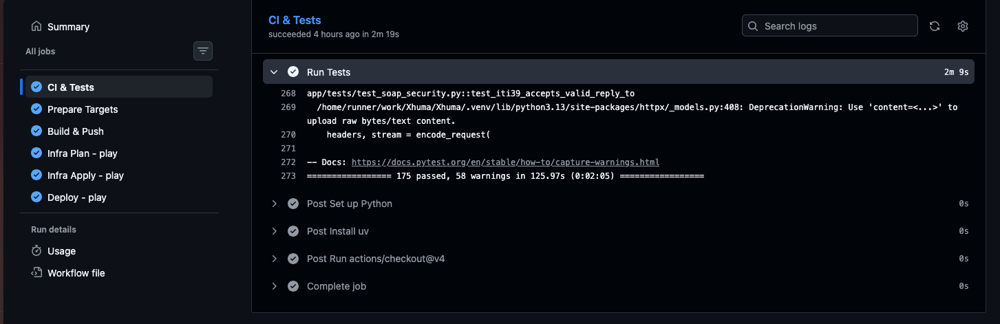
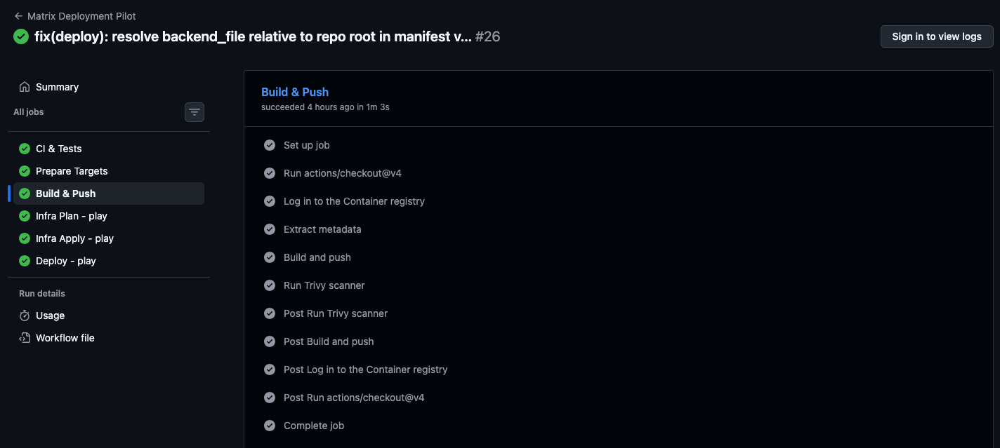
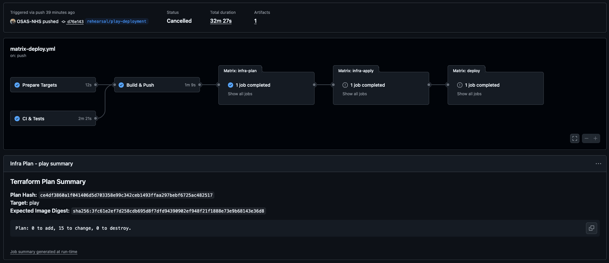
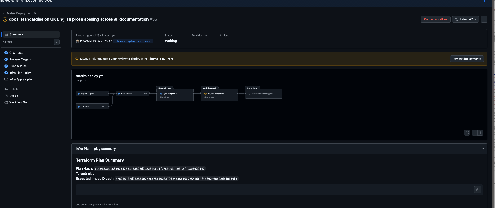
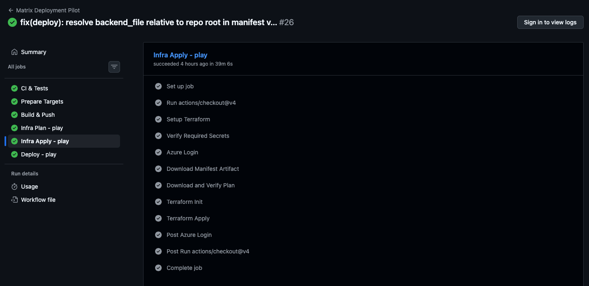
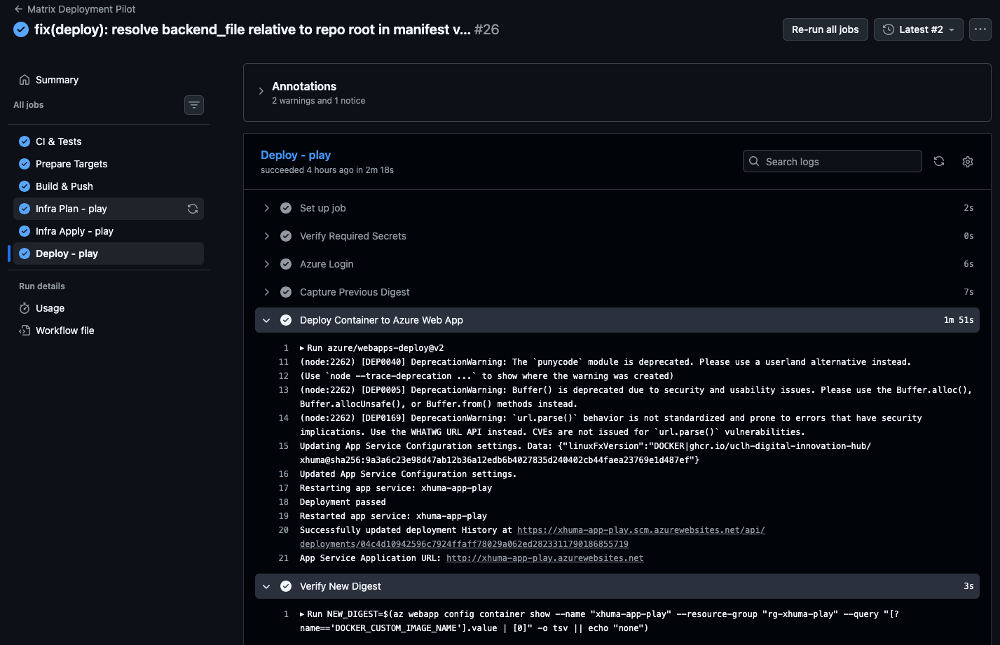
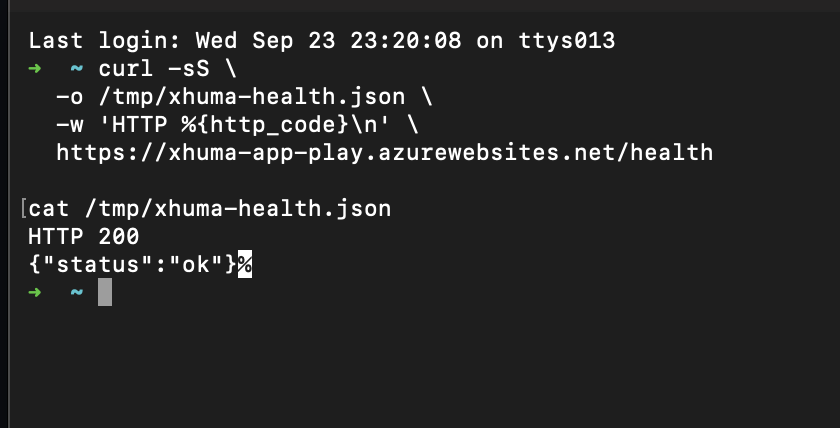

# Xhuma Operator's Manual

**Document Purpose:** This manual provides a comprehensive, authoritative, end-to-end runbook for deploying, configuring, verifying, and maintaining the Xhuma middleware across NHS Trust environments (Play, INT, PRD). It is designed to be operational without reliance on unwritten tribal knowledge.

**Security Rule for Operators:**
> [!WARNING]
> **Screenshots and Logs:** Operational evidence must not contain credentials, tokens, patient data, certificate material, secret-valued configuration or protected infrastructure identifiers.

> **Note:** Screenshots included in this manual are illustrative evidence captured during the September 2026 Play rehearsal. Commands, configuration parameters, and invariants in this runbook are authoritative; UI screenshots may change as GitHub and Azure evolve.

> **Tired? In a hurry?** See the [Xhuma Deployment for Tired Humans](./deployment_for_tired_humans.md) quick-start guide.

---

## Table of Contents
1. [Architecture Overview & Environment Mapping](#1-architecture-overview--environment-mapping)
2. [Infrastructure Bootstrapping and State Storage](#2-infrastructure-bootstrapping-and-state-storage)
3. [Azure Service Principal & Permissions](#3-azure-service-principal--permissions)
4. [Setting Up Variables and GitHub Environments](#4-setting-up-variables-and-github-environments)
5. [Key Vault Population](#5-key-vault-population)
6. [Deployment Orchestration and Review Gates](#6-deployment-orchestration-and-review-gates)
7. [Verification and Health Checks](#7-verification-and-health-checks)
8. [Shared Infrastructure Adoption (Terraform)](#8-shared-infrastructure-adoption-terraform)
9. [Operational Observability & Shared Query Pack](#9-operational-observability--shared-query-pack)
10. [dm+d Cache Warmer Operations and Diagnostics](#10-dmd-cache-warmer-operations-and-diagnostics)
11. [Quick Operator Commands](#11-quick-operator-commands)
12. [Assurance and Evidence Records](#12-assurance-and-evidence-records)

---

## 1. Architecture Overview & Environment Mapping

Xhuma utilises a **target-isolated deployment model with centrally managed shared services**. Every target environment (Play, INT, PRD) receives its own dedicated cloud footprint for compute, cache, database, and networking to ensure strict multi-tenant blast-radius containment and prevent cross-contamination of health data.

### 1.1 Environment Promotion Sequence

Environment promotion follows a strict, pull-request-driven progression:

```text
feature/* ──(PR)──> dev ──(PR)──> int ──(PR)──> main
                      │             │             │
                      ▼             ▼             ▼
                     Play          INT           PRD
```

| Branch | Target Environment | Target Directory / Backend | Deployment Workflow |
| :--- | :--- | :--- | :--- |
| `dev` | **Play** | `infra/backends/play.hcl`, `infra/env/play.tfvars` | `.github/workflows/matrix-deploy.yml` |
| `int` | **INT** | `infra/backends/int.hcl`, `infra/env/int.tfvars` | `.github/workflows/matrix-deploy.yml` |
| `main` | **PRD** | `infra/backends/prd.hcl`, `infra/env/prd.tfvars` | `.github/workflows/matrix-deploy.yml` |

- **Target-Local Resources:** Each environment receives a dedicated Azure App Service for containers, target-isolated VNet and subnets, target-local Managed Redis, target-local PostgreSQL audit database, target-local Key Vault, and target-local Log Analytics / Application Insights workspace.
- **Shared Resources:** A separately managed Azure Resource Group (`rg-xhuma-shared`) hosts services with independent lifecycles, such as the Public JSON Web Key Set (JWKS) via Blob Storage and the Shared Key Vault for NHS-wide API keys, signing keys, and dm+d credentials.

---

## 2. Infrastructure Bootstrapping and State Storage

Terraform state and reviewed execution plans are stored securely in Azure Blob Storage. Each target has its own storage account within its target resource group.

### 2.1 Bootstrapping Procedure
The target-agnostic setup script establishes the backend storage:

1. **Target Configuration**: Verify target definitions in `infra/targets.json` and backend coordinates in `infra/backends/<target>.hcl`.
2. **Execution**: The `matrix-deploy.yml` workflow automatically runs the bootstrap script:
   ```bash
   export AZURE_SUBSCRIPTION_ID="<your-subscription>"
   export AZURE_TENANT_ID="<your-tenant>"
   export XHUMA_BACKEND_FILE="infra/backends/play.hcl"
   bash infra/bootstrap/setup-target.sh
   ```
   This provisions the state storage account and blob containers in the target resource group. The `tfplans` container automatically expires files after 7 days to prevent unbounded plan retention.

*(Note: Entra Blob authentication and OIDC are scheduled as subsequent hardening changes. We currently use interim storage-key authentication and long-lived Service Principal credentials.)*

---

## 3. Azure Service Principal & Permissions

To allow GitHub Actions to deploy infrastructure and code, Xhuma relies on a Service Principal with client secrets:

1. **Target Resource Group Permissions**: The SP requires Contributor and User Access Administrator (or scoped RBAC equivalent) over the target Azure Resource Group and state backend.
2. **Shared Key Vault Access Prerequisite**: The Terraform configuration manages network access rules and access policies on the shared Key Vault. The Service Principal requires sufficient rights to manage these policies.
3. **Expiry & Rotation**: Ensure the deployment credential is rotated before expiry. Update the relevant GitHub Secret (`AZURE_CREDENTIALS`) upon rotation.

---

## 4. Setting Up Variables and GitHub Environments

### 4.1 Matrix Deployment Workflow

Deployments rely on protected GitHub Environments to enforce strict manual approval gates between Plan generation, Infrastructure Apply, and Application Deployment.


*Figure 1 — Pre-plan approval gate — Run #32 paused before `Infra Plan - play` because the `play-plan` GitHub Environment required reviewer approval.*

**Protected Environment Gates:**

| Gate Stage | Environment Name | Required Reviewer Action |
| :--- | :--- | :--- |
| **Plan Gate** | `<target>-plan` (e.g. `play-plan`) | Approve generation of the immutable Terraform plan. |
| **Infra Apply Gate** | `<rg-target-infra>` (e.g. `rg-xhuma-play-infra`) | Review plan summary, inspect attribute paths, and approve apply. |
| **App Deploy Gate** | `<target>-app` (e.g. `play-app`) | Review scanned image digest and approve container deployment. |

**Actual Deployment Sequence:**

1. **Configure GitHub Environments & Secrets:** Ensure environments exist and deployment credentials are saved with designated human approvers.
2. **Automatic Bootstrap and Plan:** The workflow creates state storage (if missing) and executes `terraform plan`. The generated plan is uploaded securely and its SHA256 hash is published to the job summary.
3. **Review and Approved Apply:** Operators review the plan output against explicit STOP conditions. Once approved, the apply job verifies the plan hash and provisions the infrastructure.
4. **Local-Vault Onboarding:** With infrastructure provisioned, the operator injects required operational secrets (`epic-ca-cert`) into the target-local Key Vault.
5. **Approved Application Deployment:** Once the vault is ready, the deployment job replaces the inert bootstrap image with the candidate application container digest.
6. **Verification and Health Check:** The deployed container digest is verified on App Service and `/health` is checked.

---

## 5. Key Vault Population

Infrastructure and application liveness can be established before the target-local Epic CA is populated. However, `epic-ca-cert` is required before Epic/SOAP/mTLS functional acceptance.

1. `epic-ca-cert`: The target-specific Epic verification CA bundle required by application semantics (Base64 PEM) used for mutual TLS (mTLS). It may contain the direct issuing intermediate(s).
2. **Populating the Vault**: Use the Azure Portal or CLI to add the secret to the newly provisioned Local Key Vault (e.g., `<app_service_name>-kv`):
   ```bash
   az keyvault secret set \
     --vault-name "<target-kv-name>" \
     --name "epic-ca-cert" \
     --file /path/to/epic-ca-bundle.pem
   ```
   *Note: Ensure multi-line PEM files are formatted correctly (valid Base64 or standard PEM with preserved newlines).*

---

## 6. Deployment Orchestration and Review Gates

The unified deployment workflow (`.github/workflows/matrix-deploy.yml`) is the single authoritative deployment path for all environments. The legacy workflows (`infra.yml` and `cd.yml`) have been decommissioned.

### 6.1 Continuous Integration and Build Controls

Before any deployment plan is generated, the pipeline enforces strict quality and security gates:


*Figure 2 — CI & Tests stage confirming all tests pass before proceeding.*


*Figure 3 — Build & Push stage showing the immutable image build and Trivy vulnerability scan.*

### 6.2 First Deployment & Protected Plans

1. **Trigger**: Merge an approved pull request into the mapped branch (`dev` for Play, `int` for INT, `main` for PRD) following the promotion sequence `feature/*` → `dev` → `int` → `main`.
2. **Plan Generation**: The workflow generates a Terraform plan and securely uploads it to the `tfplans` container in Azure Storage. Only a non-secret plan hash and summary are published in GitHub.
3. **Review & Approval**: An authorized operator reviews the plan summary in GitHub (and the full plan in Azure Storage if necessary) using the inspection procedure below, then approves the infrastructure environment (`<rg-target-infra>`).

### 6.3 Terraform Plan Review Before Approval

When reviewing an immutable saved plan for approval, operators must follow this complete procedure to prevent accidental disruption and avoid exposing sensitive state data.

#### Explicit STOP Conditions
Do NOT approve the infrastructure apply gate if any of the following occur:

| Check | Failure Condition (STOP Immediately) |
| :--- | :--- |
| **Plan Hash** | Plan SHA-256 differs from the value in the workflow job summary. |
| **Target / Subscription** | Target, subscription ID, or resource group does not match target configuration. |
| **Destructive Replacement** | Any unexpected `destroy` or `replace` action (`-/+`) on persistent resources (Redis, PostgreSQL, Key Vault, Storage). |
| **Shared Resource Drift** | Any unintended change to shared Key Vault, shared DNS, or external networking. |
| **State Drift** | Unexplained attribute drift (e.g. tags, service endpoints, diagnostic settings). |
| **Unresolved Secrets** | Key Vault reference strings missing or unresolvable. |

#### Step-by-Step Review Procedure

1. **Select the target Azure subscription:**
   ```bash
   az account set --subscription "<target-subscription-id>"
   ```
2. **Securely obtain the plan storage credentials:**
   ```bash
   RG_NAME="<backend-resource-group>"
   SA_NAME="<backend-storage-account>"
   ```
3. **Download the exact immutable `.tfplan`:**
   ```bash
   PLAN_FILE="<plan-filename>"
   az storage blob download \
     --auth-mode login \
     --account-name "$SA_NAME" \
     --container-name tfplans \
     --name "$PLAN_FILE" \
     --file "/tmp/$PLAN_FILE"
   ```
4. **Verify SHA-256 hash:**
   ```bash
   sha256sum "/tmp/$PLAN_FILE"
   ```
   Compare the output hash with the manifest or GitHub Actions job summary. **STOP if SHA differs.**

5. **Initialise Terraform locally without connecting to remote state:**
   ```bash
   git checkout <commit-sha>
   terraform init -backend=false -input=false
   ```
6. **Review headline counts and changes:**
   ```bash
   terraform show -json "/tmp/$PLAN_FILE" | jq '.resource_changes[] | {address, actions: .change.actions}'
   ```
7. **Extract changed attribute paths only (safe from secret leakage):**
   ```bash
   terraform show -json "/tmp/$PLAN_FILE" | jq -r '
     .resource_changes[]
     | select(.change.actions != ["no-op"])
     | .address as $addr
     | (.change.before // {}) as $before
     | (.change.after // {}) as $after
     | ([($before | paths(scalars)), ($after | paths(scalars))] | unique[]) as $p
     | select(($before | getpath($p)) != ($after | getpath($p)))
     | "\($addr)\t\($p | map(tostring) | join("."))"
   '
   ```

> **Example (Play Rehearsal Drift Detection):**
> A superficially safe plan showed: `0 to add, 15 to change, 0 to destroy`.
>
> 
> *Figure 4 — Play rehearsal plan showing 0 add / 15 change / 0 destroy. Further inspection revealed unexplained drift and Apply was withheld.*
>
> Attribute-path inspection revealed that Terraform intended to remove externally-managed organisational tags and Application Insights hidden links. Apply was withheld, and Terraform configuration was corrected via `ignore_changes`.


*Figure 5 — Clean plan with 0 changes following drift reconciliation.*

### 6.4 Plan Retries & Image Deployment


*Figure 6 — Infrastructure Apply approval gate pausing at `rg-xhuma-play-infra` with plan hash and image digest visible.*


*Figure 7 — Successful infrastructure Apply job completing after manual approval.*

1. **Plan Retries & Expiry**: If the apply step fails, it can be retried and will re-download the exact same plan blob securely. Plans expire automatically after 7 days in Blob Storage. If a plan is no longer valid, a new workflow run must be triggered.
2. **Image Deployment**: After infrastructure applies the bootstrap image, the pipeline deploys the exact scanned Docker image digest. This step requires separate environment approval (`<target>-app`).


*Figure 8 — Application image deployed deterministically using exact immutable SHA-256 digest.*

### 6.5 Digest Rollback & Recovery

1. **Recovery Ownership**: If a deployment introduces regressions, authorized operators can perform a rollback.
2. **Rollback Procedure**:
   - Identify the previous known-good digest from the deployment step summary.
   - Manually redeploy the previous digest via Azure CLI:
     ```bash
     az webapp config container set \
       --name <app_service> \
       --resource-group <rg> \
       --docker-custom-image-name ghcr.io/uclh-digital-innovation-hub/xhuma@sha256:<previous-digest>
     ```
   - **PostgreSQL Compatibility Notice:** Reverting the container digest does **not** revert database schema migrations. Rollback is only safe when the previous application release is compatible with the current Alembic schema.

---

## 7. Verification and Health Checks

### 7.1 Safe Verification Boundaries
- **Liveness Probe**: The `/health` endpoint is unauthenticated and returns a coarse HTTP 200 process-liveness signal: `{"status":"ok"}`. It does not perform downstream NHS requests or leak credentials.
- **Process Liveness vs Clinical Readiness:** HTTP 200 on `/health` proves process and container liveness. It does **not** prove end-to-end clinical readiness (e.g. Spine connectivity, valid mTLS certificates, or populated cache keys).
- **Manual Clinical Check**: Because GitHub Actions runners lack clinical mTLS certificates, a manual synthetic check must be performed from a trusted clinical workstation to verify SOAP mTLS, SAML validation, and audit persistence.

### 7.2 Post-Deployment Health Verification

Run this reproducible command to verify application liveness:

```bash
curl -sS \
  -o /tmp/xhuma-health.json \
  -w 'HTTP %{http_code}\n' \
  https://<app_service>.azurewebsites.net/health

cat /tmp/xhuma-health.json
```


*Figure 9 — Post-deployment liveness verification: Play App Service returned HTTP 200 with `{"status":"ok"}`.*

### 7.3 Key Vault Reference Verification

Ensure App Service `@Microsoft.KeyVault(...)` configuration references are resolved:

```bash
az webapp config appsettings list \
  --name <app_service> \
  --resource-group <rg> \
  --query "[?contains(value, '@Microsoft.KeyVault')].{name:name, value:value}" \
  -o table
```

**Verification Sequence:**
1. Confirm App Service managed identity exists.
2. Confirm access policy on shared vault (`Get`, `List` secrets).
3. Confirm App Service subnet is permitted by shared vault network ACL.
4. Confirm reference status is `Resolved`.
5. **STOP** if status is `AccessToKeyVaultDenied`, `SecretNotFound`, or unresolved.

### 7.4 HSCN Relay Observability & Diagnostics

The WebSocket relay hub consumes and sanitises client-side diagnostics (`relay_logs`) attached by the HSCN relay client:
- Emitted with prefix `relay_diag <json>` into standard Application Insights traces.
- `outcome = "ok"` proves relay transport succeeded; an HTTP 500 can still be an upstream application failure.
- `outcome = "upstream_error"` indicates communication failure between relay and upstream Spine / GP practice.
- `outcome = "blocked"` indicates firewall, proxy, or mTLS authorization failure.

---

## 8. Shared Infrastructure Adoption (Terraform)

The shared Key Vault is adopted into a separate shared Terraform state. The matrix workflow automatically:
- Reads the current shared Key Vault network ACL;
- Preserves existing rules;
- Adds only the target App Service subnet;
- Guards the shared plan with `guard_shared_plan.py` to fail closed if unexpected changes are proposed;
- Verifies the subnet is present post-apply.

---

## 9. Operational Observability & Shared Query Pack

### 9.1 Shared Azure Monitor Query Pack

Operational diagnostics across Play, INT, and PRD are standardised through a shared Azure Monitor Query Pack:

| Property | Value |
| :--- | :--- |
| **Resource Name** | `xhuma-operational-diagnostics` |
| **Resource Group** | `rg-xhuma-shared` |
| **Full Catalogue & Guide** | [Observability & Diagnostics Guide](observability.md) |

### 9.2 Key Operational Boundaries
1. **Stores Queries, Not Telemetry:** The Query Pack stores KQL query definitions only; it does not store logs, aggregate telemetry, or create an extra Log Analytics Workspace.
2. **Scoping:** The exact same queries are executed in the context of the target environment's Log Analytics Workspace or Application Insights component.
3. **RBAC Isolation:** Access to the Query Pack and access to underlying telemetry are separate. An operator must have reader permissions on the target resource group to view telemetry.

### 9.3 How to Run Queries
1. Open the [Azure Portal](https://portal.azure.com).
2. Navigate to the target resource group (`rg-xhuma-play`, `rg-xhuma-int`, or `rg-xhuma-prd`).
3. Open the target's **Log Analytics Workspace** or **Application Insights** instance.
4. Click **Logs**, open **Query Packs**, and select `xhuma-operational-diagnostics`.
5. Run the required diagnostic query. See [Observability & Diagnostics](observability.md) for the complete 20-query catalogue and symptom decision matrix.

---

## 10. dm+d Cache Warmer Operations and Diagnostics

The dm+d cache warmer operates as a target-local Azure Container Apps Job (`azurerm_container_app_job.dmd_warm`) provisioned with a **manual trigger configuration**. It pre-populates target-local Redis DB 2 with resolved `DMDConcept` representations so clinical prescription conversions execute with sub-millisecond local latency.

### 10.1 Operational State Across Environments

| Environment | Current Implemented State | Required v1.0 Operational Baseline |
| :--- | :--- | :--- |
| **Play (`rg-xhuma-play`)** | Warmer infrastructure enabled (`dmd_cache_warm_enabled = true`); scheduler disabled. | Warmer infrastructure enabled; manual execution operational. |
| **INT (`rg-xhuma-int`)** | Warmer infrastructure disabled (inherits default `false`); scheduler disabled. | **Warmer infrastructure MUST be explicitly enabled** (`dmd_cache_warm_enabled = true` in INT target tfvars). |
| **PRD (`rg-xhuma-prd`)** | Warmer infrastructure disabled (inherits default `false`); scheduler disabled. | **Warmer infrastructure MUST be explicitly enabled** (`dmd_cache_warm_enabled = true` in PRD target tfvars). |

> [!IMPORTANT]
> **v1.0 Implementation Note:** The warmer is standard target-local operational infrastructure for INT and PRD in v1.0. Enabling it must occur via explicit per-target tfvars configuration (`dmd_cache_warm_enabled = true` in `infra/env/int.tfvars` and `infra/env/prd.tfvars`), **not** by changing the global Terraform default to true.

### 10.2 Terminology Publication Schedule & Operational Timing

- **Project Operational Assumption:** Refreshed upstream dm+d releases are normally expected to become available at approximately **04:00 UK local time on Monday** via the NHS Terminology Server. This is a project operational planning assumption based on observed release operations, **not** an externally guaranteed NHS SLA. Occasional small publication delays can occur.
- **Xhuma Warm Target:** Xhuma targets warming at approximately **05:00 UK local time on Monday**, providing a one-hour publication buffer.
- **DST-Aware Recurrence:** Azure recurrence uses `GMT Standard Time`, keeping the schedule aligned with UK local time across GMT and BST.
- **No Cache Purge:** Xhuma operates strictly on the model:
  $$\text{discover} \longrightarrow \text{warm} \longrightarrow \text{verify} \longrightarrow \text{activate} \longrightarrow \text{retire naturally by TTL}$$
  New release keys are versioned (`dmd:resolved:v1:<release>:<concept_id>`). The active release pointer (`dmd:active-release`) is atomically updated only after full verification. The prior release is not destructively deleted; old keys expire naturally under their 9-day TTL. **Never describe normal dm+d operation as a "purge".** `FLUSHDB` and wildcard `KEYS *` are strictly prohibited.

### 10.3 Release-Freshness Operational Caveat

> [!WARNING]
> **Release-Freshness Limitation:**  
> The current warmer implementation discovers whatever upstream release is visible at execution time. It does **not** currently require the discovered release to differ from the already-active release before completing a successful warm.  
> Therefore:
> - A `warm_succeeded` event proves a technically successful complete warm.
> - It does **NOT** by itself prove that the newly expected weekly release was visible upstream.
> - If upstream publication were delayed beyond the scheduled run, Xhuma could successfully re-warm the previous release.
>
> Future scheduler/watchdog acceptance must verify:
> 1. Successful execution
> 2. Cache completeness
> 3. Zero evictions
> 4. Active pointer health
> 5. Release freshness/advancement where a new upstream release is expected

### 10.4 Scheduler State & Manual Triggering

- **Scheduler Implementation:** The automated Azure Logic App scheduling path exists in Terraform (`infra/main.tf`), but `dmd_cache_schedule_enabled` is **deliberately blocked by fail-closed assertions** (`condition = !var.dmd_cache_schedule_enabled`) pending acceptance of the missed-success/freshness watchdog. Automated scheduling is not active in any environment.
- **Warmer Infrastructure Enabled != Scheduler Enabled:** The Container Apps Job remains manually triggerable via CLI or Azure Portal even when automatic recurrence is disabled.

### 10.5 Proven Safety Invariants

1. **Job Execution Timeout:** 1800 seconds (`replica_timeout_in_seconds = 1800`).
2. **Zero Replica Retries:** `replica_retry_limit = 0`. Platform retries are prohibited to prevent colliding with the held distributed lock.
3. **Scheduler Polling Envelope:** 2100 seconds (`local.dmd_logic_poll_timeout_seconds = 2100`).
4. **Distributed Warmer Lock TTL:** 2700 seconds (`local.dmd_lock_ttl_seconds = 2700`, acquired at `dmd:warm:v1:lock`).
5. **Strict Timeout Hierarchy:** $1800\text{s (job)} < 2100\text{s (poll)} < 2700\text{s (lock)}$.
6. **Dedicated Digest-Pinned Image:** Job runs the immutable digest (`var.dmd_cache_job_image`).
7. **Runtime Key Vault Credential Resolution:** Resolves `dmd-client-id` and `dmd-client-secret` at runtime via user-assigned managed identity.
8. **Redis Memory Safety Preflight:** Aborts before writes if current memory + projected delta with 1.5x multiplier exceeds 80% of `maxmemory`.
9. **Zero Eviction Tolerance:** Aborts immediately if `evicted_keys` increases by even 1 key during warming.
10. **Grace Period Coexistence:** 9-day data TTL vs 8-day active pointer TTL provides a 24-hour grace window during schedule delays.
11. **Prohibited Commands:** `FLUSHDB` and wildcard `KEYS *` are strictly forbidden.

### 10.6 Trigger Manual Job Execution

```bash
az containerapp job start \
  --name <app-service-name>-dmd-warm \
  --resource-group <resource-group>
```

### 10.7 Check Execution Status & Logs

```bash
# List executions
az containerapp job execution list \
  --name <app-service-name>-dmd-warm \
  --resource-group <resource-group> \
  -o table

# Query logs in Log Analytics
az monitor log-analytics query \
  --workspace "$LAW_ID" \
  --analytics-query '
ContainerAppConsoleLogs_CL
| where ContainerJobName_s == "<app-service-name>-dmd-warm"
| where TimeGenerated > ago(2h)
| project TimeGenerated, Log_s
| order by TimeGenerated desc
' \
  -o table
```

### 10.8 Operational Failure Modes and Recovery

1. **What a failed warm means:**
   - Active release pointer (`dmd:active-release`) remains untouched, pointing to the prior release.
   - The prior release data remains valid for up to 9 days (24-hour grace window).
   - If the active pointer expires, the application degrades gracefully to unversioned on-demand terminology lookup (`snomed:<concept_id>`). Clinical prescription conversion is never interrupted.
2. **Instance-Wide Redis Memory Safety:**
   - Redis `maxmemory` and eviction policies are instance-wide across all logical databases (DB 0 application, DB 1 PDS, DB 2 dm+d).
   - Preflight checks and zero-eviction guards prevent dm+d warming from evicting active PDS cache or application session keys.

---

## 11. Quick Operator Commands

Use these safe generic commands to inspect environments. Replace placeholders with actual environment values.

- **Current Azure subscription:**
  ```bash
  az account show --query name -o tsv
  ```
- **App Service managed identity:**
  ```bash
  az webapp identity show --name <app_service> --resource-group <rg> --query principalId -o tsv
  ```
- **SHA-256 plan verification:**
  ```bash
  sha256sum <target>-plan.tfplan
  ```
- **Changed Terraform resources/actions:**
  ```bash
  terraform show -json <target>-plan.tfplan | jq '.resource_changes[] | {address, actions: .change.actions}'
  ```
- **Changed Terraform attribute paths:**
  ```bash
  terraform show -json <target>-plan.tfplan | jq -r '
    .resource_changes[]
    | select(.change.actions != ["no-op"])
    | .address as $addr
    | (.change.before // {}) as $before
    | (.change.after // {}) as $after
    | ([($before | paths(scalars)), ($after | paths(scalars))] | unique[]) as $p
    | select(($before | getpath($p)) != ($after | getpath($p)))
    | "\($addr)\t\($p | map(tostring) | join("."))"
  '
  ```
- **App Service health:**
  ```bash
  curl -s https://<app_service>.azurewebsites.net/health
  ```
- **Key Vault reference verification:**
  ```bash
  az webapp config appsettings list --name <app_service> --resource-group <rg> --query "[?contains(value, '@Microsoft.KeyVault')].{name:name, value:value}" -o table
  ```
- **Currently deployed container digest:**
  ```bash
  az webapp config show --name <app_service> --resource-group <rg> --query 'linuxFxVersion' -o tsv
  ```
- **Workflow run inspection:**
  ```bash
  gh run view <run-id>
  ```

---

## 12. Assurance and Evidence Records

Specific deployment rehearsals, cutovers, and clean-room convergence tests are preserved as immutable historical evidence records:

- [Play Matrix Deployment Rehearsal (23 September 2026)](../assurance/evidence/2026-09-23-play-matrix-deployment-rehearsal.md)
- [Play Clean Room Rebuild and Convergence (25 September 2026)](../assurance/evidence/2026-09-25-play-clean-room-rebuild-and-convergence.md)
- [INT Matrix Cutover Record (6 October 2026)](../assurance/evidence/2026-10-06-int-matrix-cutover.md)
- [PRD State Reconciliation Record (9 October 2026)](../assurance/evidence/2026-10-09-prd-state-reconciliation.md)
- [Medical Device Regulatory Statement](../assurance/medical_device_statement.md)
