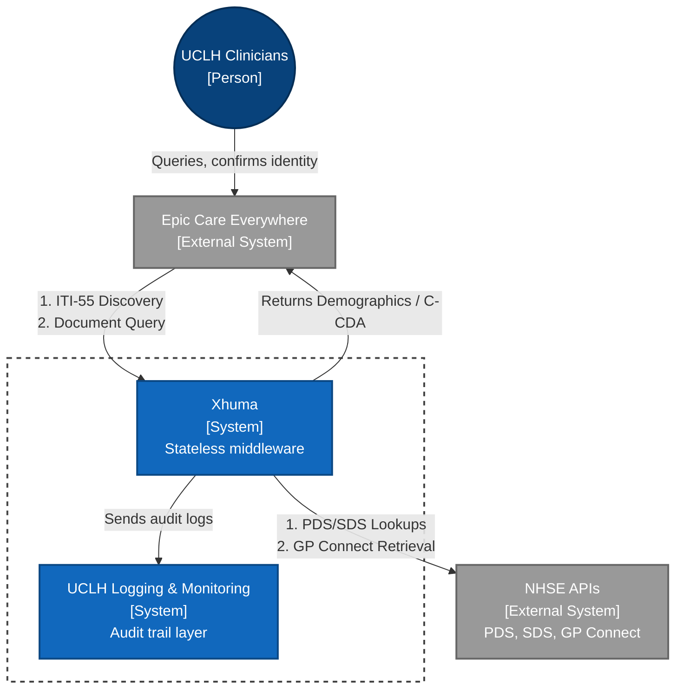
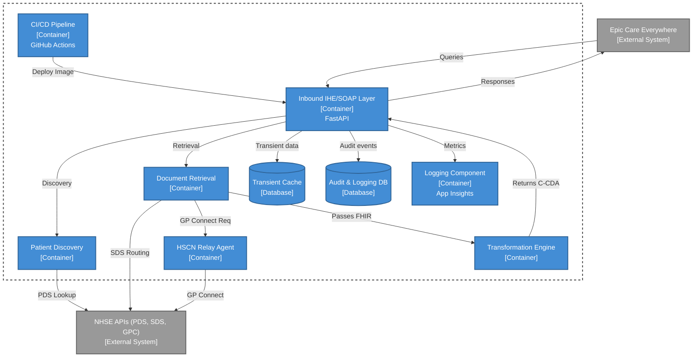
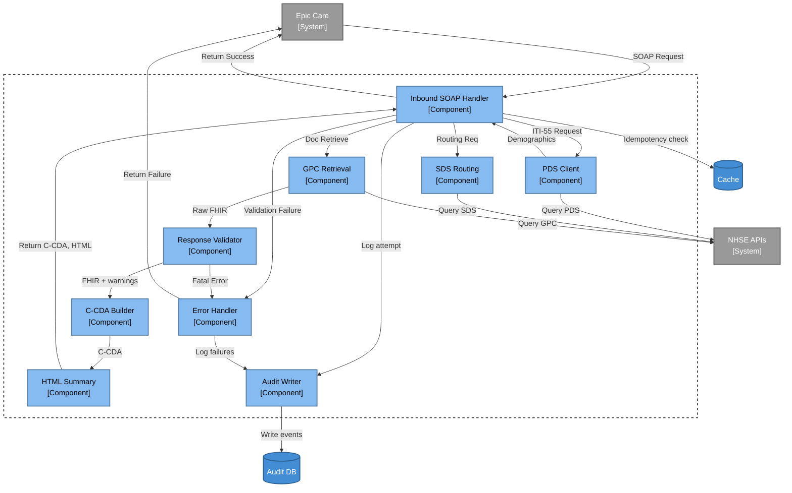
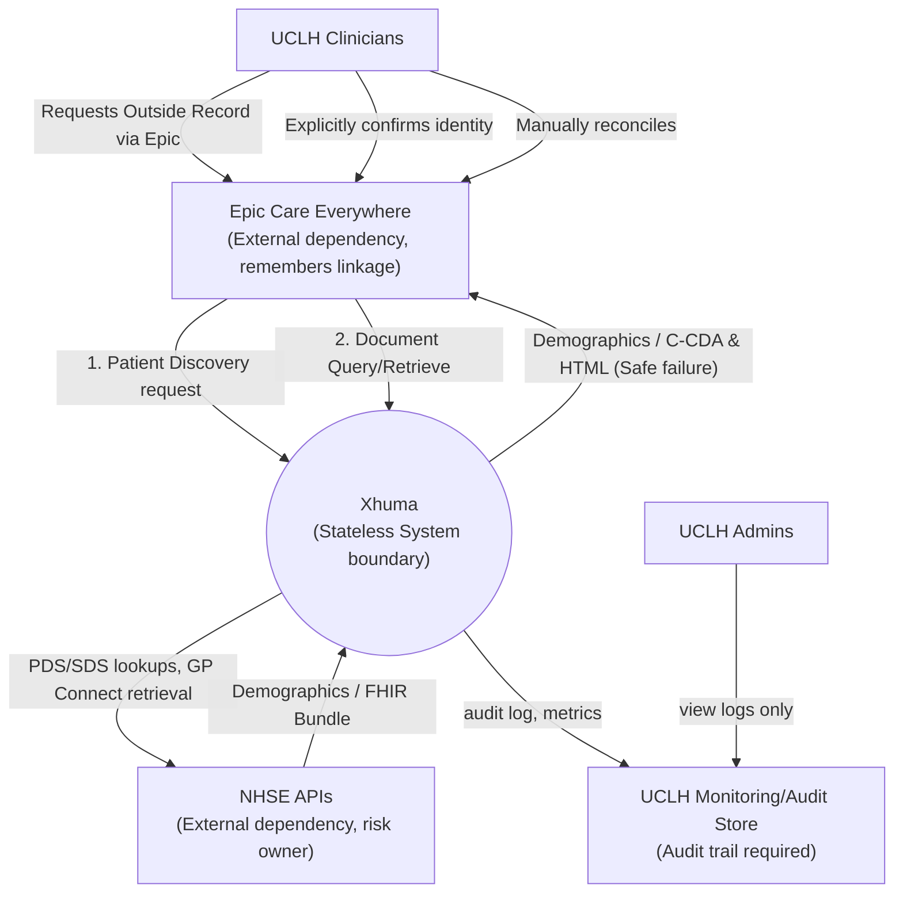
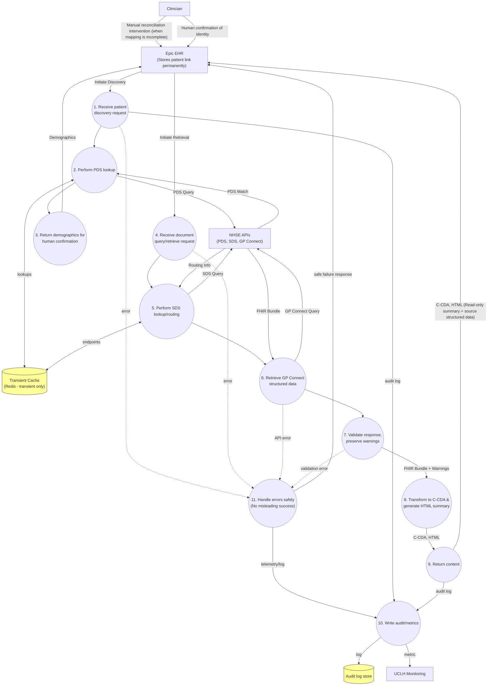
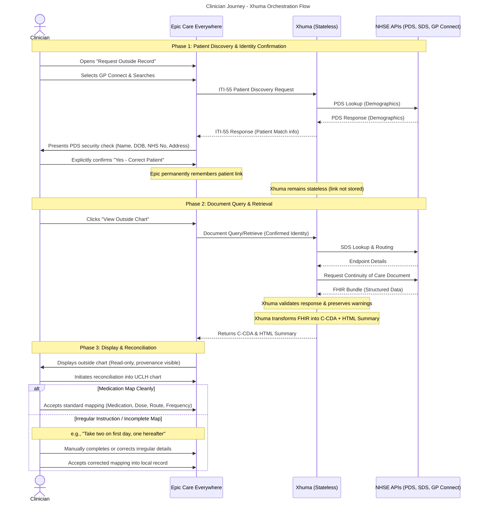
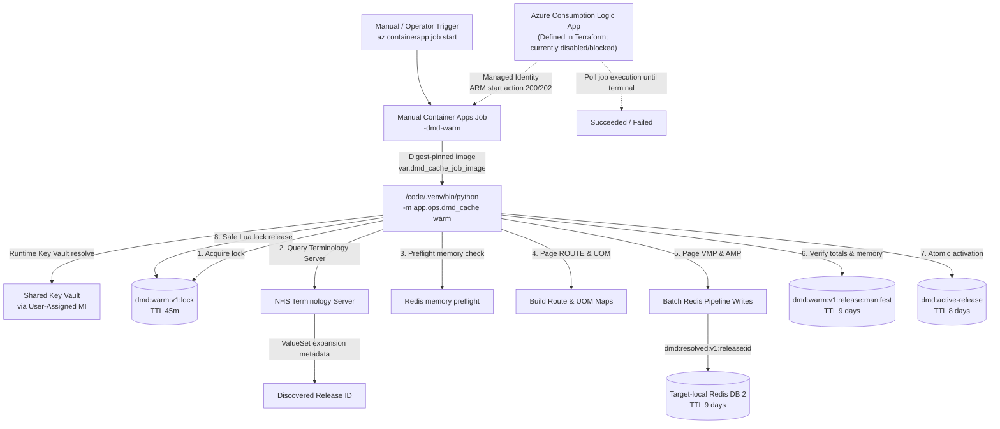

# Technical Architecture Documentation

## System Overview
Xhuma is a stateless middleware service designed to facilitate the conversion of GP Connect structured records into CCDA (Consolidated Clinical Document Architecture) format. The service acts as an intermediary between Electronic Health Record (EHR) systems and NHS APIs, providing seamless integration and data transformation capabilities.

## Architecture Diagrams

*(Note: The following diagrams align Xhuma's system model to clinical workflows and DTAC/DCB0160 assurance expectations, explicitly highlighting Epic as the system of record and Xhuma as stateless middleware.)*

### System Context


### Container Diagram


### Component Diagram


### Data Flow Diagrams

#### DFD Level 0 (Context)


#### DFD Level 1 (Detailed)


### Clinician Journey / Workflow Sequence


## Security, Governance & Data Minimisation

Xhuma implements strict data governance controls to align with NHS Information Governance (IG) frameworks and the National Data Sharing Arrangement (NDSA).

### Role-Based Access Control (RBAC) & Break The Glass
Xhuma relies on Epic Care Everywhere as the authoritative system of record for identity and access management. 
- **RBAC:** Only authorised clinicians with appropriate Epic security classes can initiate Xhuma queries.
- **Break The Glass:** Epic's native 'Break The Glass' functionality is enforced prior to Xhuma retrieving GP Connect data, requiring clinicians to explicitly state their reason for accessing outside records. This decision is cryptographically audited and passed back to the NHS via SAML assertions.

### Hardcoded Purpose of Use
Xhuma strictly enforces the `directcare` purpose. The middleware explicitly blocks any attempts to query the GP Connect API for research, secondary uses, or population health analytics.

### Data Minimisation Scope
To adhere to data minimisation principles, Xhuma scopes its GP Connect structured record retrieval strictly to `patient/*.read`. It only requests the specific clinical domains required for safe direct care (e.g., Allergies, Medications, Immunisations), explicitly excluding sensitive or unnecessary administrative data where possible.

## Error Handling & Graceful Degradation

Xhuma implements a robust **Global Exception Handling** architecture designed to prevent internal server errors from leaking sensitive stack traces, while remaining strictly compliant with downstream parsing expectations.

### Centralized Exception Catching
All unhandled exceptions (e.g., parsing failures on malformed FHIR payloads) are caught by a global middleware hook in `app/main.py`. The raw python stack trace is suppressed from the client and instead securely logged to Azure Application Insights with a unique Trace ID.

### Context-Aware Error Payloads
When a fatal error is caught, Xhuma dynamically determines the originating route and returns a clinically safe, specification-compliant error payload:
- **REST/FHIR Routes:** Returns a standard FHIR `OperationOutcome` resource.
- **IHE/SOAP Routes (Epic ITI-38/ITI-55):** Returns a standard `SOAP Fault` envelope (incorporating an IHE `RegistryErrorList`) so that Epic can cleanly abandon the transaction without crashing the clinician's workspace.
- **Other Routes:** Returns a standard RFC 7807 `application/problem+json` payload.

### Delta Summary & Assumptions

**Changes from previous version:**
- **Epic Ownership & Statelessness**: Shifted diagram labels and structures to identify Epic explicitly as the ultimate EHR UI, reconciling owner, and keeper of the patient link. Xhuma is now rigorously documented as a stateless orchestrator with cache used only for transient optimisation.
- **Workflow Separation**: Separated the single unified interactions into two distinct paths: Patient Discovery (ITI-55) & Identity Confirmation, followed by Document Query & Retrieval.
- **Clinician Intervention visibility**: Updated the DFD Level 0/1 and Context diagram to show clinicians directly interacting with Epic with explicit human confirmation steps and manual reconciliation steps.
- **Observability Stack Constraint**: Pared down monitoring boxes to explicitly respect the network architecture document baseline (eliminating extrapolated components).
- **New Sequence Diagram**: Added a "Clinician Journey" sequence diagram delineating the explicit step-by-step clicks from PDS confirmation down to the reconciliation of dirty vs. clean medication texts.

**Assumptions / TBDs:**
- **TBD-01**: Identity/Auth beyond core mTLS for incoming Epic requests and clinician tracing.
- **TBD-02**: Exact granularity of UCLH telemetry observability access controls (e.g., who accesses dashboards) and role-based access logic for the Postgres audit tables.

## Core Components

### 1. API Layer (FastAPI)
- Handles incoming ITI (IHE IT Infrastructure) requests
- Manages request/response lifecycle
- Implements REST endpoints for health systems integration
- Provides async operation support for improved performance

### 2. Authentication & Security (`app/security.py`)
- Implements JWT token validation
- Manages API authentication
- Handles request signing for NHS API interactions
- Ensures secure communication channels

### 3. GP Connect Integration (`app/gpconnect.py`)
- Manages communication with GP Connect APIs
- Handles structured record retrieval
- Implements error handling and retry logic
- Maintains API version compatibility

### 4. CCDA Conversion Engine (`app/ccda/`)
- Transforms FHIR bundles to CCDA format
- Implements conversion logic for clinical data
- Manages document structure and formatting
- Handles various clinical entry types

### 5. PDS Integration (`app/pds/`)
- Manages Patient Demographic Service lookups
- Handles patient identity verification
- Implements NHS number validation
- Manages demographic data retrieval

### 6. SOAP Handler (`app/soap/`)
- Processes SOAP requests and responses
- Manages XML transformations
- Implements ITI transaction support
- Handles SOAP fault scenarios

### 7. Caching Layer (Redis)
- **Infrastructure Configuration**
  - Memory limit: 256MB with volatile-lru eviction
  - Persistence: RDB snapshots and AOF journaling
  - Network: Isolated container network
  - Security: Password authentication, protected mode

- **Client Implementation** (`app/redis_connect.py`)
  - Async `redis.asyncio.Redis` clients with separate document and terminology connection pools
  - Awaited commands and pipeline execution; atomic document publication
  - Automatic retries with nonblocking async delays
  - Pool cleanup during application shutdown and partial startup failure
  - Comprehensive error handling
  - Memory usage monitoring
  - Structured logging

- **Cache Management**
  - Intelligent key expiry
  - Memory usage monitoring
  - Cache statistics collection
  - Health checks and diagnostics

- **Data Types**
  - CCDA documents (4-hour TTL, DB 0)
  - PDS lookup results (24-hour TTL, DB 1)
  - SDS endpoint information (12-hour TTL, DB 1)
  - NHS number mappings (DB 1)
  - dm+d pre-warmed terminology concepts (9-day TTL, DB 2)

### 8. dm+d Terminology Cache & Warmer Architecture

The Dictionary of Medicines and Devices (dm+d) cache warmer ensures that high-volume medication concept resolutions execute with deterministic sub-millisecond latency from target-local Redis rather than making blocking network calls to the NHS Terminology Server during clinical document conversion.

For clinical dosage and route mapping specifications, see [dm+d Mapping Overview](dm+d_mapping.md).
For operational procedures, failure triage, and CLI instructions, see [Operator's Manual](operators_manual.md#94-dmd-cache-warmer-operations-and-diagnostics).

#### Publication & Warm Schedule
- **NHS dm+d Publication**: Weekly on Monday at approximately 04:00 UK time via TRUD / NHS Terminology Server.
- **Xhuma Target Pre-warm Intent**: Weekly on Monday at 05:00 UK local time (`GMT Standard Time`, DST-aware across GMT/BST), with optional per-target minute offset (`dmd_cache_warm_minute`) to prevent simultaneous upstream thundering herds across trusts.
- **Buffer & Operational Assumption**: The one-hour gap provides a buffer for upstream publication processing. Upstream publication can occasionally experience small delays. This timing is the project's operational planning assumption, not an externally guaranteed NHS SLA.
- **No Cache Purge**: Xhuma warms versioned release keys (`dmd:resolved:v1:<release>:<concept_id>`) in the background and atomically updates the active release pointer (`dmd:active-release`) only after successful verification. Old release keys age out naturally under their 9-day TTL. No destructive cache purge (`FLUSHDB` or `KEYS *`) is part of the normal operating model.

> [!NOTE]
> **Operational Caveat on Release Discovery**: The current warmer discovers whatever release is currently visible upstream at execution time. A successful job execution alone does not prove that a newly expected upstream release was visible if upstream publication was delayed. Future missed-success/freshness monitoring must verify release freshness/advancement as well as job execution success.

#### Architecture Flow


#### Key Architectural Principles
1. **Target-Local / Shared-Nothing**: Each target environment has its own Container Apps Job provisioned with a **manual trigger configuration** and warms its own target-local Redis DB 2. There is no shared terminology microservice and no public/HTTP control endpoint.
2. **Environment Enablement State**:
   - **Play (`rg-xhuma-play`)**: Warmer infrastructure is enabled (`dmd_cache_warm_enabled = true`). Container Apps Environment, Job, user-assigned managed identity, and delegated `ca-subnet` are active.
   - **INT (`rg-xhuma-int`) & PRD (`rg-xhuma-uclh-prd`)**: Warmer infrastructure is currently disabled (`dmd_cache_warm_enabled = false`).
   - **Scheduler State**: The automated Azure Logic App recurrence trigger is implemented in Terraform (`infra/main.tf`), but `dmd_cache_schedule_enabled` is deliberately blocked by a Terraform precondition and check assertion (`condition = !var.dmd_cache_schedule_enabled`) pending acceptance of a missed-success watchdog. The scheduler is not active in any environment.
3. **Runtime Key Vault Credential Resolution**:
   - The warmer Job resolves `dmd-client-id` and `dmd-client-secret` at runtime directly from Key Vault using the Job's user-assigned managed identity (`AZURE_CLIENT_ID` and `KEY_VAULT_URL`).
   - This removes the need for Key Vault secret references in the Container Apps Job template during bootstrap and decouples Job resource creation from shared Key Vault network ACL reconciliation. Secrets and tokens are never logged.
4. **Dedicated Digest-Pinned Job Image**: The Container Apps Job image is managed via `var.dmd_cache_job_image` (`${REGISTRY}/${IMAGE_NAME}@${build digest}`). App Service deployment ownership remains with `azure/webapps-deploy` and ignores image-name drift; only the Container Apps Job image is updated in Terraform (`0 to add, 1 to change, 0 to destroy`).
5. **Guarded Shared Key Vault Network Admission via Terraform Outputs**:
   - Post-apply workflow reads applied Terraform outputs from the initialized target state (`dmd_cache_ca_subnet_id`, `dmd_cache_job_name`, `dmd_cache_job_image`).
   - App Service subnet is expected unconditionally.
   - Container Apps Job subnet (`ca_subnet`) is added to the shared Key Vault allowed subnet set *only* when `dmd_cache_ca_subnet_id` is non-null.
   - Job image verification runs only when `dmd_cache_job_name` is non-null, comparing the live image against the expected immutable GHCR digest.
   - Plan guarding (`guard_shared_plan.py`) rejects subnet removals, unknown subnet additions, and any other shared resource modification.
6. **Logic App Scheduling, Invariants & RBAC**:
   - Time zone: `GMT Standard Time` (Monday 05:xx UK local time, DST-aware).
   - Target-configurable start time: `dmd_cache_schedule_start_time` (local `YYYY-MM-DDTHH:MM:SS` format without Z) emitted via `azurerm_logic_app_trigger_custom`.
   - Invariants: `schedule_enabled => warm_enabled`, start time required when schedule enabled, alert action group required when schedule enabled.
   - Start action handles both HTTP 200 (`body.name`/`body.id`) and HTTP 202 (`Location` header polling).
   - Scoped RBAC actions: `Microsoft.App/jobs/read`, `Microsoft.App/jobs/start/action`, `Microsoft.App/jobs/executions/read`, `Microsoft.App/locations/containerappsjoboperationstatuses/read`, `Microsoft.App/locations/containerappsjoboperationresults/read`, `Microsoft.App/managedEnvironments/read`. No wildcards and no `listSecrets`.
   - Timing invariant: `replica timeout (1800s) < poll timeout (2100s) < lock TTL (2700s)`.
7. **Platform Retries and Distributed Lock Safety**:
   - `replica_retry_limit = 0`: Platform retries are disabled because a new replica process generates a distinct random lock token while the prior token is still held. Application-level retries for transient HTTP errors occur inside the single running job execution.
   - Distributed lock renewal and release use atomic, token-verified Lua scripts.
8. **Real Monotonic HTTP Retry Budget**:
   - Upstream Terminology queries are governed by an overall 120-second monotonic deadline (`time.monotonic() + budget`).
   - Per-attempt connect, read, write, and pool timeouts are strictly clamped to the remaining deadline: `min(default, remaining)`.
   - `Retry-After` headers and exponential backoffs that would cross the deadline abort immediately without sleeping.
   - Upstream 401 Unauthorized responses trigger at most one in-memory OAuth token refresh per client run without touching Redis.
9. **Disjoint Namespaces & Canonical Raw Cache Keys**:
   - Resolved concepts (`dmd:resolved:v1:<release>:<concept_id>`): Only serialized `DMDConcept` instances.
   - Raw lookups (`dmd:raw:v1:<release>:<concept_id>:properties:<canonical_sig>`): Raw FHIR Parameters dictionaries returned by `get_dmd_concept`.
   - Canonical property signature: `properties=None` and `properties=[]` canonicalize to `none`. Non-empty property lists are whitespace-trimmed, deduplicated, and sorted lexicographically (e.g. `ROUTECD,VPI,parent`), preventing property set collisions.
   - Upstream lookups on cache misses are explicitly pinned to the active release; responses with mismatched releases are rejected before caching.
10. **Warm -> Verify -> Activate Invariant**: Data is pre-warmed into versioned keys. The active pointer (`dmd:active-release`) is updated *only* after all categories complete successfully, totals are verified, and zero Redis key evictions occurred.
11. **Natural TTL Retirement (No Purge)**:
    - Resolved concepts (`dmd:resolved:v1:...`): **9 days** TTL
    - Active release pointer (`dmd:active-release`): **8 days** TTL
    - Success manifest (`dmd:warm:v1:...:manifest`): **9 days** TTL
    The active pointer expires before underlying data expires, ensuring a 24-hour grace window for schedule failures while preventing orphaned pointers. Old release data ages out naturally without requiring destructive Redis operations (`DEL`, `KEYS`, `FLUSHDB`). `FLUSHDB` and wildcard `KEYS *` are strictly prohibited to avoid blocking the single-threaded Redis event loop and risking cross-database eviction or data loss.
12. **Redis Memory Safety & Coexistence Overhead**:
    - **Instance-Wide Physical Memory Sharing**: Redis `maxmemory` and eviction policies are **instance-wide across all logical databases (DB 0 application sessions, DB 1 PDS cache, DB 2 dm+d terminology cache)**. Redis DB 2 shares physical memory with DB 0 and DB 1. An eviction in DB 2 could evict active clinical sessions or PDS data.
    - Sizing models correspond exactly to actual writes: raw lookups (ROUTE + UOM), resolved concepts (VMP + AMP), Redis key/dictEntry overhead (~128 bytes per key), allocator fragmentation (1.25x), and old-release coexistence during the warm.
    - Preflight check verifies that current memory + projected delta with safety multiplier (1.5x) does not exceed 80% of `maxmemory`. Both preflight and per-batch guards fail closed immediately if `maxmemory <= 0`.
    - If `evicted_keys` increases during warm, the run aborts immediately and refuses activation.
13. **Sequential Concurrency & Duration Projection**:
    - Terminology expansion requests execute sequentially (concurrency = 1).
    - The capacity model projects total HTTP requests: discovery and sampling requests (8) plus expansion pages (`ceil(ROUTE/1000) + ceil(UOM/1000) + ceil(VMP/1000) + ceil(AMP/1000)`).
    - Projected duration is calculated as `request_count * p95_latency`. The warmer and capacity plan fail closed if projected duration exceeds the 1800s Container Apps Job execution timeout.
14. **Heartbeat Telemetry & Blocked Scheduler**:
    - Upon warm success, the job emits a structured JSON event: `dmd_cache_event {"event": "warm_succeeded", "release": "...", "duration_seconds": ..., "concept_count": ..., "memory_delta_bytes": ..., "evictions": 0}`.
    - Scheduled Query Rules in Azure Monitor strictly cap query lookback windows to 48 hours (`P2D` / 2880 mins). Therefore, a direct 7.5-day heartbeat alert is not safely implementable directly via AzureRM scheduled query alerts.
    - The Logic App scheduler is intentionally blocked by both a Terraform precondition and a check assertion (`condition = !var.dmd_cache_schedule_enabled`) until a 48h-compatible missed-success watchdog is designed and accepted. Play currently has warmer infrastructure enabled (`dmd_cache_warm_enabled = true`), but its scheduler is disabled (`dmd_cache_schedule_enabled = false`). In INT and PRD, warmer infrastructure remains disabled (`dmd_cache_warm_enabled = false`, `dmd_cache_schedule_enabled = false`).

#### Runtime Fallback Behaviour
When `dmd_lookup(concept_id)` executes during prescription conversion:
1. It queries `dmd:active-release`.
2. **Hit with Active Release**: Checks `dmd:resolved:v1:<release>:<concept_id>`. On hit, returns the resolved `DMDConcept` immediately with zero external network calls.
3. **Miss with Active Release**: Resolves the concept on-demand via the Terminology Server pinned to that active release, writes the resolved `DMDConcept` to `dmd:resolved:v1:<release>:<concept_id>`, and returns it.
4. **No Active Release**: Falls back transparently to unversioned on-demand resolution (`snomed:<concept_id>`). A failed Monday warmer never breaks medication processing.

## Monitoring & Observability Architecture

Xhuma currently uses Azure Application Insights and Log Analytics to collect telemetry. The sections below outline the current foundation and the intended future tooling for advanced observability.

### 1. Current Telemetry (Azure Monitor / App Insights)
- **Implemented:** Distributed tracing, request tracking, error logging, and Application Insights integration.
- **Outstanding:** Proactive Azure alert rules, action groups, and automated operator notification are not yet fully codified in the current Terraform deployment model, but alert rules also exist in the live Azure environment.

### 2. Local Development Tooling (Prometheus & Grafana)
Prometheus and Grafana are available in the local Docker Compose development stack. Production target environments currently use the Azure Monitor / Application Insights / Log Analytics stack.

### 4. Distributed Tracing (OpenTelemetry)
- **Trace Collection**
  - Request tracing
  - Service dependencies
  - Performance bottlenecks
  - Error propagation

- **Trace Analysis**
  - Latency analysis
  - Error tracking
  - Service mapping
  - Performance optimisation

## Testing Architecture

### 1. Unit Testing
- **Test Organisation**
  - Feature-based test suites
  - Integration test suites
  - Mock implementations
  - Test fixtures

- **Test Coverage**
  - Code coverage tracking
  - Branch coverage
  - Integration points
  - Error scenarios

### 2. Integration Testing
- **Service Testing**
  - API endpoint testing
  - Database interactions
  - Cache operations
  - External service mocks

- **End-to-End Testing**
  - User flow testing
  - Error handling
  - Performance validation
  - Security testing

### 3. Performance Testing
- **Load Testing**
  - Concurrent user simulation
  - Resource utilisation
  - Response time analysis
  - Bottleneck identification

- **Stress Testing**
  - System limits testing
  - Recovery testing
  - Failover scenarios
  - Resource exhaustion

## Security Architecture

### 1. Authentication
- JWT-based authentication
- NHS API authentication
- Token validation and verification
- Redis password protection

### 2. Data Protection
- TLS 1.2+ for all communications
- Data encryption at rest
- Secure header handling
- Input validation and sanitisation
- Redis protected mode

### 3. Compliance
- NHS Digital Standards
- NHS Supplier Conformance Assessment List: Structured Extended Testing, Spine Integration Testing, PDS onboarding
- GDPR requirements
- Health data protection regulations

## Deployment Architecture

### 1. Matrix Deployment Model
Xhuma uses a target-isolated matrix deployment workflow (`.github/workflows/matrix-deploy.yml`) driven by target definitions in `infra/targets.json`.

```text
feature/* → dev → int → main
              │      │      │
              ▼      ▼      ▼
            Play    INT    PRD
```

- **PR-Based Promotion**: Promotion across environments is strictly pull-request-based. Direct unreviewed branch pushes are not used for releases.
- **Target Isolation**: Each target environment (Play, INT, PRD) maintains its own isolated Terraform remote state in Azure Blob Storage within its dedicated resource group (`rg-xhuma-<target>`).
- **Controlled Stages & Approval Gates**: Infrastructure Plan, infrastructure Apply, and application deployment are distinct controlled stages protected by GitHub Environment approval gates.
- **Immutable Scanned Digest Propagation**: Candidate images are built and scanned for CVEs via Trivy in CI. The verified image is pinned to an immutable SHA-256 digest (`ghcr.io/uclh-digital-innovation-hub/xhuma@sha256:...`) and propagated across all deployment steps.
- **Fail-Closed Migration Guards**: Brownfield environments (`INT` and `PRD`) enforce fail-closed existing-state preflight checks (`require_existing_state = true`) to prevent accidental resource deletion or unadopted resource recreation. Any unexpected destroy or replacement action halts deployment immediately.
- **Guarded Shared Key Vault Network Admission**: Shared Key Vault network ACLs are reconciled via target-specific ephemeral plans strictly guarded by `guard_shared_plan.py` to admit target subnets while preserving all existing rules.

### 2. Container Structure & Target Topology
```
├── Azure App Service (Linux Web App)
│   ├── Application Container (FastAPI, Uvicorn, Python 3.12/3.14)
│   └── Inbound TLS / mTLS termination, WebSocket tunnel
├── Azure Managed Redis (Cache DB 0, DB 1, DB 2)
├── Azure Flexible PostgreSQL (Audit persistence & configuration)
├── Azure Key Vault (Target-local secrets & certificate allowlists)
└── Container Apps Job (dm+d warmer in Play; manual trigger, UAI Key Vault resolution)
```

### 3. Network Configuration
- Virtual Network (VNet) integration with dedicated subnets:
  - `app-subnet`: Dedicated to App Service integration
  - `db-subnet`: Delegated to PostgreSQL Flexible Server
  - `ca-subnet`: Delegated to Container Apps Environment (`Microsoft.App/environments`) with `Microsoft.KeyVault` service endpoint
- Service endpoints and network ACLs restrict Key Vault, PostgreSQL, and Redis access.
- Exposed external endpoints:
  - HTTPS / 443: Application API (SOAP and REST)
  - Managed Redis: 6380 (TLS-only, internal/firewalled)
  - PostgreSQL: 5432 (TLS-only, internal/firewalled)
- Exposed ports:
  - 8000: Application API
  - 6379: Redis (internal only)

## Error Handling Architecture

### 1. Error Categories
- NHS API errors
- Conversion failures
- Authentication errors
- Network issues
- Cache operation failures

### 2. Recovery Procedures
- Automatic retries with backoff
- Connection pool management
- Error reporting
- System recovery
- Cache rebuilding

## Maintenance Architecture

### 1. Regular Maintenance
- Cache cleanup and monitoring
- Log rotation
- Performance monitoring
- Security updates
- Redis persistence management

### 2. Support Procedures
- Issue tracking
- Version control
- Documentation updates
- Dependency management

## Health Check Architecture

### 1. Liveness Probes
- Basic application health
- Critical service checks
- Resource availability
- Error rate monitoring
- Redis connection status

### 2. Readiness Probes
- Service dependencies
- Cache availability
- External service status
- Resource thresholds
- Memory usage checks

### 3. Startup Probes
- Initialisation checks
- Configuration validation
- Resource allocation
- Service registration
- Redis persistence verification
